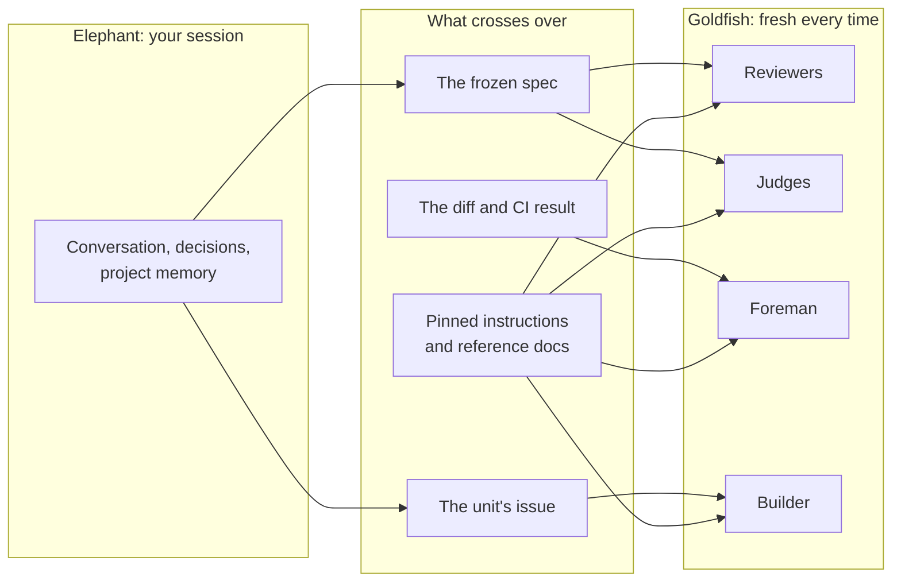
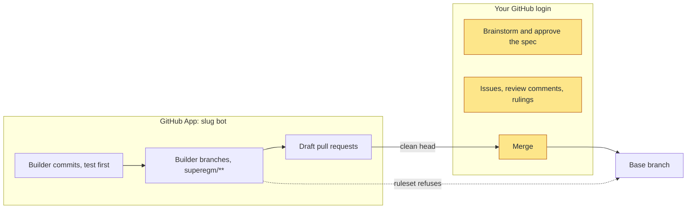
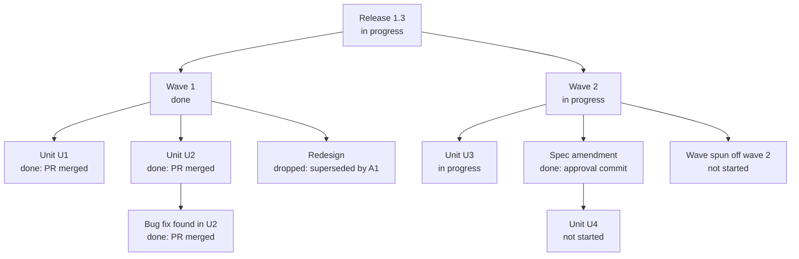
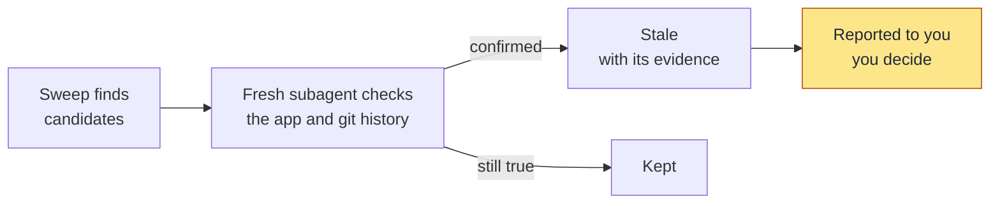
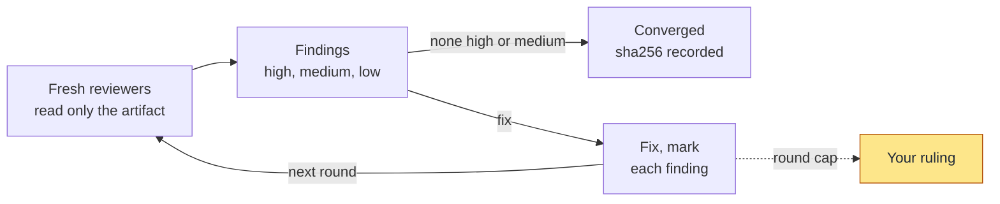
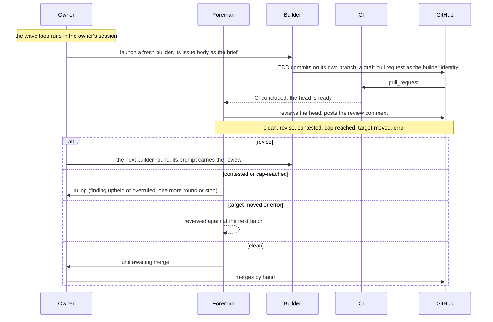

# SuperEGM

<!-- Modified by SuperEGM (gsVAM), 2026: U01's skeleton filled in by U11; U11's README restructured for the public with diagrams; the 1.2 docs sweep (U29); the 1.2.0 release README: what's new, install from GitHub and why, the setup map, the documentation table.; the inaugural public README (1.2): the pitch, the story, the feature tour, the compact review figure.; the 1.3 release README: tracks and lineage, the sweep, memory and context, the engineering practices, human and agent work kept apart, the view for engineering leaders, what it is not. -->

<p align="center"></p>

<h3 align="center">An AI engineering team that ships reviewed pull requests,<br>keeps track of its own work, and can never merge without you.</h3>

<p align="center"><strong>The Super Elephant-Goldfish Model</strong> · one Claude Code plugin, from an idea to merged pull requests</p>

<p align="center">
  <a href="https://github.com/gsVAM/superegm/releases/latest"></a>
  <a href="https://github.com/gsVAM/superegm/actions/workflows/tests.yml"></a>
  
  
</p>

<p align="center"><a href="#whats-new-in-13">New in 1.3</a> · <a href="#memory-and-context-the-elephant-and-the-goldfish">Memory</a> · <a href="#engineering-practices-enforced-not-suggested">Practices</a> · <a href="#human-work-and-agent-work-kept-apart">Agent identity</a> · <a href="#lineage-every-piece-of-work-is-a-track">Tracks</a> · <a href="#staleness-the-sweep">Sweep</a> · <a href="#for-engineering-leaders">For leaders</a> · <a href="#install">Install</a> · <a href="#documentation">Docs</a></p>

SuperEGM turns Claude Code into a small, disciplined software team that works in your GitHub repository. You describe an idea. A team of agents brainstorms it with you. Reviewers who have never seen your conversation pick the design apart until it holds. The approved design becomes one GitHub issue per unit of work, and fresh builders work those issues in parallel: test first, each on its own branch, each opening its own pull request under the team's own GitHub identity, never yours. Every pull request is reviewed again, against the design and against CI, before it reaches you.

Then you merge. Only you can.

## What's new in 1.3

1.3 is about **not doing the same work twice, and not being misled by work that is already done.** An agent that reads a stale TODO, an old plan or an out-of-date line in `CLAUDE.md` treats it as an instruction. 1.3 gives the team a memory of what is finished and a way to clear out what is no longer true.

| | Before 1.3 | In 1.3 |
| --- | --- | --- |
| **What is finished?** | Spread across issues, pull requests, the journal and your head | Every piece of work is a **track** with a status, an origin, links and closing evidence |
| **Where did this come from?** | A bug fix found during a wave lived in a comment thread | A track records the track it came from, so the tree of work can be walked in any direction |
| **Is this TODO still real?** | An agent might act on it, closed or not | **`/superegm:sweep`** finds stale TODOs, plans, specs and rules-file lines, and a separate fresh agent checks each one against the app and git history before anything is called stale |
| **Design docs against code** | `/superegm:drift-report` | Unchanged, and now one of three hygiene tools with a clear job each |
| **Wave leftovers** | `/superegm:clean`, typed by hand before 1.2.1 | Removed automatically since 1.2.1; `/superegm:clean` stays for anything abandoned |

Everything from 1.2.1 ships with it: the review round cap is configuration (3 by default), the phases can chain on their own once you approve a spec, the inbox asks you questions in plain words with the agent's recommended answer first, builders check their own work before they push, a later fix round resumes the builder's session, and every finished build leaves a post-mortem. Details are in [What's inside](#whats-inside).

> **What 1.3 does not claim.** Tracks and the sweep are new. They have no field measurements yet, and nothing in this README quotes someone else's numbers as SuperEGM's result. Where a figure appears, it comes from SuperEGM's own build records or from the cited source, and says which.

## Why it exists

Ask one AI session to design, build and check a feature, and four things go wrong:

- **It drifts.** Hours in, the design in its head is no longer the one you agreed on.
- **It grades its own homework.** The session that wrote the code is the worst judge of it.
- **It forgets.** A decision you made before lunch is gone by the evening.
- **It gets distracted.** It reads a comment about a bug that was fixed months ago and goes off to fix it again.

The first three are the problem Google's Elephant-and-Goldfish Model was built for. Google's Open Source Blog introduced it in October 2026 ([Introducing the Elephant-Goldfish Model plugin](https://opensource.googleblog.com/2026/10/introducing-elephant-goldfish-model-plugin.html)): an *elephant*, "a context-rich, long-horizon AI session that holds the end-to-end architectural vision and project memory", and *goldfish*, "stateless, zero-context sessions used strictly to validate specifications". Dave Rensin's essay [Elephants, Goldfish, and the New Golden Age of Software Engineering](https://drensin.medium.com/elephants-goldfish-and-the-new-golden-age-of-software-engineering-c33641a48874) makes the wider argument: design is the new code. SuperEGM is a fork of [google/elephant-goldfish-model](https://github.com/google/elephant-goldfish-model) that carries that idea from the design all the way to merged pull requests.

The fourth is what 1.3 is for. In November 2026 Google's Developers Blog published [Agent Distraction](https://developers.googleblog.com/agent-distraction/), a study of millions of agent sessions in Google's own codebase. Among its findings, all from Google's internal traces:

- 13% of the file-reading sessions exposed the agent to an inline `TODO(bug/...)` or `FIXME(bug/...)` reference. Agents ignored the reference 94% of the time; in 6% of encounters they acted on that bug, and 83% of those actions were not something the developer had asked for.
- More than two-fifths of those unprompted detours chased tickets that were already closed, fixed or obsolete. In over half, the bug was still open and the agent widened the job it had been given.
- Sessions with an unprompted bug detour took 70% more steps, 77% more tokens and 105% more wait time (statistically significant, p<0.0001).
- Google's response was cleanup agents that confirmed a TODO and its reason were obsolete before proposing to remove it. Over six months they removed thousands of obsolete references, with more than 95% of the changes accepted by human reviewers.

Their summary: "What is easy for humans to skim past in code, agents see as a call to action." SuperEGM's tracks and sweep take that lesson to a working repository: record what is finished so agents can see it, and check stale material against the real code and history before anyone deletes it. Google's figures describe Google's codebase and tooling; they are the reason for these features, not a forecast of what they will do in yours.

### One session against a team

| | One long AI session | SuperEGM |
| --- | --- | --- |
| **Design** | Lives in the chat, changes as it goes | A written spec, reviewed by agents who never saw the chat, frozen at a sha256 on approval |
| **Plan** | Implicit | One test-first plan per unit, reviewed against the spec, filed as a GitHub issue |
| **Who checks the code** | The session that wrote it | A fresh foreman per pull request head, which re-runs the checks itself, plus CI |
| **Who merges** | Whoever holds the credential | Only you: a repository ruleset keeps every agent identity off the base branch |
| **Git history** | Your name on everything | Agent commits under the SuperEGM GitHub App, your commits and merges under yours |
| **What is done** | Whatever the session remembers | Tracks with status and closing evidence |
| **Stale TODOs and rules** | Read as instructions | Found by the sweep, verified against the app and git history by a fresh agent |
| **After the build** | A long transcript | A journal, review records, rulings, launch records and a post-mortem |

## Memory and context: the elephant and the goldfish

SuperEGM splits the work between two kinds of session, and the split is the whole design.

- The **elephant** is the long-memory session: yours. It brainstorms, drafts, plans, drives the waves and remembers everything. That memory is also why it is biased toward its own intentions.
- The **goldfish** is a fresh, isolated, zero-context session: reviewer, judge, foreman, builder. It sees only the artifact and the evidence attached to its dispatch, so it finds what the elephant can no longer see.



The conversation itself never crosses. Each goldfish gets the artifact it judges or builds, and nothing else.

| Session | What it remembers | What it is given | What it never sees |
| --- | --- | --- | --- |
| Elephant (you and your Claude Code session) | Everything | Everything | Nothing is hidden from it, which is the problem |
| Spec and plan reviewers | Nothing | The artifact, the standards for its kind, and from round 2 the last round's findings with the fixes marked | Your conversation, your `CLAUDE.md` |
| Builder | Nothing at launch; a later fix round resumes its own earlier session | Its issue, its orders, the rulings on its issue, pinned instructions | Your planning conversation, your profile's hooks, plugins and servers |
| Foreman | Nothing | The pull request head, CI's result, the unit's definition of done | Your conversation |
| Judges | Nothing | One question and its evidence | Your conversation |

**Isolation is recorded, not assumed.** Goldfish are dispatched with `omitClaudeMd: true`, and every dispatch record carries what the goldfish reported seeing: `clean`, or `exposed:<what>` when something leaked in. A builder runs in its own empty profile with `--strict-mcp-config`, so it loads exactly the plugins and MCP servers you list for builders, and each launch records them.

**Memory that outlives the session.** The elephant's memory is not only its context window. Every handoff keeps a store outside your working tree: the journal, every review round and finding, every ruling, every launch, and the board. A new session, or a new owner, reads the store rather than a transcript. 1.3's tracks add the last piece: what is finished, why, and where it came from.

**Context that is pinned, not pasted.** The `instructions` list in `.superegm/config.json` routes repository rules files to builders, the foreman, reviewers and judges. A folder of reference documents (`{"dir": "docs/reference", ...}`, at most 50 files) is given as an index, read when the work touches it. Both are frozen at approval by blob sha and recorded on every dispatch, so you can tell exactly which version of which rule an agent saw.

## What it feels like

1. **Monday, 9:00.** You open Claude Code in your repository and describe a feature in a paragraph. With `--team`, four agents work the idea with you: a cartographer reads your code, then an architect, a skeptic and an advocate each argue an approach and challenge one another. Out comes a design document that ends in a list of units of work, and the brainstorm goes on to set up how this project will be built: which reviewers, which rules files, the round cap, the mode, the builder.
2. **9:40.** You type `/superegm:review-spec`. Reviewers who see only the document, never your chat, find the gaps: a missing error path, two sections that disagree, a unit too big to build alone. The spec is fixed and reviewed again until nothing serious is left. You approve it, and its hash is frozen.
3. **10:15.** With the chain on, plan, plan review and filing follow by themselves: one GitHub issue per unit, each a test-first plan a stranger could follow, linked to the units it depends on. In normal mode the chain stops once for you to confirm the filing.
4. **10:30.** Builders start, each a fresh session on its own branch, pushing as your SuperEGM GitHub App, never as you. Each checks its own work before it pushes. A foreman reviews every pull request, re-runs its checks and sends back anything that is not right.
5. **Overnight.** In leave-me-alone mode a panel of judges rules on contested findings instead of you. One question splits the panel, so it waits. Your inbox asks it in plain words, with the agent's pick first: "I'd rule (b): the builder's test covers it. Rule (b)?" You answer "yes" from your phone.
6. **Tuesday, 8:00.** You open the live board on the tracking issue. Six pull requests are clean and waiting. You read them and you merge. Nothing merged itself.
7. **Friday.** The handoff closes. Its track is done, with the merged pull requests as evidence, and so is every unit's. A post-mortem tells you where the rounds, the findings and your time went. Before the next spec, `/superegm:sweep` checks the repository for TODOs, plans and rules that this week made stale.

## The workflow at a glance

Eight phases, one skill each. The yellow steps are the human's. With `driver.chain` on, the phases after your approval run on their own and stop only for a decision the workflow raises.

```mermaid
flowchart LR
  P0["0 Brainstorm<br/>a spec ending in Units"] --> P1["1 Spec review<br/>converged or ruled"]
  P1 --> H1["Owner pushes<br/>the approval commit"]
  H1 --> P2["2 Plan<br/>graph and scan pass"]
  P2 --> P3["3 Plan review<br/>converged or ruled, per unit"]
  P3 --> P4["4 File<br/>dry run confirmed"]
  P4 --> P5["5 Wave<br/>every head clean"]
  P5 --> H2["6 Merge<br/>by hand"]
  H2 --> P7["7 Integrate<br/>nothing left to escalate"]
  P7 -.->|new units| P2
  P7 -.-> SW["Sweep<br/>stale material checked"]
  classDef human fill:#fde68a,stroke:#b45309,color:#1f2937
  class H1,H2 human
```



The approval commit is the one human step between phases 1 and 5: `launch` refuses the first wave until the spec on the base branch hashes to the approval. Integrate may append new units to the spec; they go through plan, plan review, file and wave again. When the build shows the spec is wrong, `superegm respec` corrects one section in place: a narrowed review of the diff alone, an approval on the same handoff, and only the units the change touches are rebuilt.

## Engineering practices, enforced not suggested

Most agentic workflows ask the model to follow good practice. SuperEGM puts each practice behind a gate that a fresh session, a script or GitHub checks, and leaves a record behind.

| Practice | What enforces it | What it leaves behind |
| --- | --- | --- |
| **Spec-driven development** | No builder launches until the base branch carries the approved spec, byte for byte (sha256) | The approval commit and the frozen spec |
| **Adversarial design review** | A panel of isolated reviewers, each with its own lens (design, zoom-out, readiness, proportion, structure, style, comprehension and more), round after round until nothing high or medium stands, or you rule | Every round's findings, fixes and dispositions |
| **Test-driven development** | Every unit's plan is red, green, commit, with the test code written out; the foreman checks test-first order on the head | The unit's commits, test first |
| **Tests cannot be talked past** | The foreman checks the test delta: a test removed or weakened is a high finding only you can allow | The finding and your ruling |
| **Evidence over claims** | The foreman re-runs every definition-of-done command itself rather than trusting pasted output | The review comment on the pull request |
| **Goldfish review** | Reviewers, judges and the foreman start with zero context and are dispatched without `CLAUDE.md` | `clean` or `exposed:<what>` on every dispatch |
| **Judges for disputes** | Contested findings go to a panel of isolated judges that converges per question; a split waits for you | The panel's verdict file and the ruling it posted |
| **CI gates** | Every builder head gets CI through a `pull_request` workflow; the foreman waits for it, and clean means CI green | CI runs on every head |
| **Small units** | `scan` refuses a unit over the size limits (25 KB body, 10 files, 16 steps by default) and the plan splits it | The plan as filed |
| **Human merge** | A ruleset lets only the owners update the base branch; the foreman and driver never merge or approve | Merges under your login |
| **Learning from each build** | `superegm postmortem` writes a numbers-only report from the store; `/superegm:retro` turns its lessons into edits for the next spec | `postmortem.md`, the retrospective's edits |

**How independent is the review?** Every goldfish is independent of the elephant's context. That is not the same as being independent of the model. By default every reviewer, the foreman and two of the three judges are Claude models: reviewers run on `opus` at `xhigh` effort, and the judge panel is `fable` and `opus` plus `astra`, a GPT-model judge that runs only when the optional Astra lane is set up (it needs the Codex CLI and `astra.enabled`). With `judges.min_vendors` at its default of 1, a Claude-only panel can rule, and its record says the panel was degraded. If you want every verdict to cross a model vendor, turn the Astra lane on and set `judges.min_vendors` to 2.

## Human work and agent work, kept apart

Every commit a builder makes and every pull request it opens is made under the **SuperEGM GitHub App**, as `<slug>[bot]`, never under your account. Your own commits, your approvals and your merges stay under yours. Six months from now, `git log` still tells you which lines an agent wrote and which a person did.



| | Agent work | Human work |
| --- | --- | --- |
| **Identity** | `<slug>[bot]`, the SuperEGM GitHub App | Your `gh` login |
| **Credential** | A one-hour installation token, minted per `gh` call by `superegm builder-token` from the App's private key; no token is stored | Your own |
| **Commits** | The builder's git author and committer, on `superegm/**` branches | Your commits and the approval commit |
| **Pull requests** | Draft, opened by the App | Merged by you |
| **Base branch** | Refused by the repository ruleset | Only `config.owners` may update it |
| **Workflows** | No Workflows permission, so a builder cannot change the CI that judges it | Yours to change |

The issue bodies, comments, reviews and labels the plugin writes go under your `gh` login, because it acts for you there; the builder identity is for code. A machine account with its own token is the fallback when you cannot register an App. Either way there is one builder identity per repository, and `launch` refuses to start a builder until the base branch is protected against it.

This is visible in SuperEGM's own history: of the last 200 commits on `main` when 1.3 was cut, 103 are by `superegm-builder[bot]` and the rest are the owner's own commits and merges.

**For a leader, this is the audit trail.** You can answer "what share of this release did agents write?", "who approved this design?" and "did a human merge every change?" from git and GitHub alone, without trusting a tool's own report. The boundary is enforced by GitHub, not by the agent's good behaviour: the agent identity cannot merge, cannot push to the base branch and cannot rewrite CI.

## Lineage: every piece of work is a track

A release, a wave, a unit, a bug fix found halfway through a wave, a redesign, an amendment to the spec, a feature, a wave spun off another wave: in 1.3 each is one **track**. A track has:

- a **status**: not started, in progress, done or dropped;
- its **origin**: the track it came from;
- **links**: the issues, pull requests, specs and records it touches;
- **closing evidence**: what shows it is done, or why it was dropped.

Tracks form a tree that can branch in any direction: a bug fix can come out of a unit, a new wave out of an old one, a redesign out of a review finding. Units and handoffs are tracks already, so most of the tree builds itself as the workflow runs.



*An illustrative tree, not a real build.*

**Why it matters.** The failure Google's Agent Distraction study measured is an agent spending effort on work that was already finished. A track that says **done**, with its closing evidence, is the thing an agent can check before it starts: this bug was fixed in that pull request, this redesign was dropped for that reason. Lineage also answers the question every reviewer and every new owner asks: *why does this exist, and what did it come from?*

| Without tracks | With tracks |
| --- | --- |
| A TODO names a bug; the agent cannot tell it was fixed last week | The bug's track is done, with the pull request that fixed it |
| A side fix found during a wave is a comment nobody can find later | It is a track whose origin is the unit it was found in |
| "Is the redesign still on?" means reading three threads | The redesign's track is dropped, and says what superseded it |
| A wave spun off another wave is a new list with no history | Its origin is the wave it came from |

**Tracks and GitHub.** A unit's GitHub issue is still its builder's brief and the place you rule; the live board is still on the tracking issue. A track is the record of status and lineage across all of them, including work that never had an issue.

## Staleness: the sweep

Agents follow what they read. A TODO about a fixed bug, a plan for a design that changed, a line in `CLAUDE.md` about a module that no longer exists: each one is an instruction to an agent, and a wrong one.

`/superegm:sweep` looks for that material across the repository:

- **TODOs and FIXMEs in code** that point at work already done or no longer wanted;
- **outdated plans and specs** that describe a design the code no longer has;
- **lines in `CLAUDE.md` and other rules files** that no longer match the repository.

**Nothing is called stale on suspicion.** Each candidate goes to a separate, fresh subagent that checks it against the actual application and its git history before it is reported as stale. The agent that found a candidate is not the agent that convicts it: the same split of finding and judging that runs the rest of SuperEGM.



This follows the lesson of Google's cleanup agents, which confirmed a TODO and its reason were obsolete before proposing a change; it is not a claim that SuperEGM will match their acceptance rate. Like everything else here, nothing reaches your base branch except by your merge.

### Three hygiene tools, three jobs

| Tool | What it checks | Against what | When |
| --- | --- | --- | --- |
| `/superegm:sweep` | TODOs in code, plans and specs, `CLAUDE.md` and other rules files | The actual app and git history, by a fresh subagent | Before a new spec, or whenever the repository has moved on |
| `/superegm:drift-report` | Every design document | The code | Typed by you after `/superegm:integrate` |
| `/superegm:clean` | Worktrees, refs and local files a wave left behind | The store | Automatic for finished units since 1.2.1; typed for an abandoned wave |

## Documentation the workflow keeps

Documentation is a by-product of the workflow, not a chore after it.

| Artifact | Written by | Where it lives | What it answers |
| --- | --- | --- | --- |
| The spec | The brainstorm, then the spec review | `docs/specs/` in the repository | What are we building, and why? |
| The approval | You | A commit on the base branch | Which exact bytes were approved? |
| One plan per unit | `plan`, then `plan review` | The unit's GitHub issue | How is this unit built and checked? |
| The board | `status` | The tracking issue | Where is every unit right now? |
| Review records | Every review round | The store | What was found, fixed and ruled? |
| Launch records | Every builder launch | The store | Which plugins and MCP servers did each builder load? |
| Tracks | The workflow, from 1.3 | With the workflow's records | What is done, and where did it come from? |
| Reference documents | You, or the brainstorm offers to draft them | A folder you name, such as `docs/reference` | What must every agent know about this codebase? |
| The post-mortem | `superegm postmortem` | `postmortem.md` beside the handoff | Where did the rounds, findings and your time go? |
| The retrospective | `/superegm:retro` with you | Edits to reference docs, reviewers and config | What should the next build do differently? |

The store sits under `artifacts_dir`, outside the working tree, and is never committed. The spec, the approval and the issues are in your repository and on GitHub, where your team already looks.

## What's inside

### Think it through before anything is built

- **Team brainstorm.** `/superegm:brainstorming --team` (or `brainstorm.team` in the config) runs the brainstorm with four agents. A cartographer maps what your code already has. An architect, a skeptic and an advocate each work one approach in their own context and challenge each other's claims. They run as Claude Code agent teams when those are enabled, and as ordinary subagents otherwise.
- **A spec reviewed by strangers.** A panel of isolated reviewers, each with its own lens (design, readiness, structure, style, comprehension, scope and more), reads the spec round after round. Findings are rated high, medium or low and go back for fixes until nothing high or medium is left. The approval freezes the spec at a sha256, and no builder starts until the base branch carries exactly those bytes.

### A plan you can read on GitHub

- **One issue per unit.** The plan is cut into units, and each unit's issue is its builder's whole brief: the test-first plan, the files it owns and its definition of done. The plan is reviewed against the spec before anything is filed. Dependencies become blocked-by links between issues.
- **Built for parallel waves.** The plan rules keep units off each other's files, so a wave can run several builders at once (`max_in_flight`).
- **The right model for each unit.** Mark a unit `Tier: difficult`, `doable` or `easy`. By default, difficult units get Opus at high effort, easy ones get Sonnet, and doable units get the builder's default model. Every role (builder, reviewer, judge) has its own model and effort, and `superegm doctor` prints them.

### Builders you do not have to trust

- **Fresh, isolated builders.** A builder is a new Claude Code session with an empty profile. It sees its issue, its orders and the rulings on its issue, never your planning conversation. It writes the failing test first, commits on its own branch, and opens a draft pull request under its own GitHub identity, a GitHub App with one-hour tokens (no second account needed), that cannot touch your base branch. It loads exactly the plugins and MCP servers you list for builders, and each launch records them.
- **A foreman that checks the work.** Every pull request head gets a foreman, another goldfish. It waits for CI, re-runs the definition-of-done commands itself rather than trusting pasted output, and checks the test delta, so a deleted or weakened test is a high finding. It then reviews the head with the panel, posts one review on the pull request and returns one word: `clean`, `revise`, or `contested` when a finding needs a ruling.
- **A second vendor, when you want one.** With the optional Astra lane (the Codex CLI), a GPT reviewer sits beside the Claude reviewers on every panel and a GPT judge on the judges' panel. Without it, panels are Claude-only and the record says so.
- **Judges for the hard calls.** In leave-me-alone mode, isolated judges on more than one model rule on contested findings, one question at a time, and a panel that does not converge waits for you.

### See everything, steer from anywhere

- **A live board.** The tracking issue on GitHub carries a table that updates itself on every status pass: each unit's state, review round, pull request, what it waits on, the next action, what its builders cost, and its tier. An illustrative board, trimmed to eight of its ten columns:

  | unit | state | round | PR | waits on | next action | cost | tier |
  | --- | --- | --- | --- | --- | --- | --- | --- |
  | U1 #12 | landed | r2 posted clean | #20 | none | none | 6.84 | doable |
  | U2 #13 | clean | r1 posted clean | #21 | none | await-merge | 3.10 | easy |
  | U3 #14 | active | none | #22 | ci | foreman dispatch | 2.45 | difficult |
  | U4 #15 | pending | r5 posted cap-reached | #23 | q4 | decision 2 | 11.37 | doable |

- **One inbox.** `/superegm:inbox` lists only what needs you: in this repository, or with `--all` across every repository you registered. If you write an executable `~/.superegm/notify`, it receives each new item, so a phone notification is one script away.
- **Answer in words.** The inbox asks each question in plain words, led by the agent's recommended answer and a one-line reason, so a "yes" is enough; it posts the ruling under your login and goes on.
- **Rule from your phone.** A `**Ruling:**` comment on a unit's issue, from an owner, is a ruling. You never have to open a terminal to unblock a unit.
- **Outside reviews count.** A review from a colleague or a review bot on a builder's pull request, or on the spec's own pull request, is ingested as findings and enters the same loop.
- **Accept early.** When only mediums and lows remain, the review says so, and you can accept without waiting out the round cap.

### Leave it running

- **Leave-me-alone mode.** Add `--leavemealone` and the judges rule at every decision point. You wake up to merge-ready draft pull requests.
- **The driver.** `/superegm:driver` installs a launchd or systemd timer that keeps your registered projects moving, one wave pass at a time, while you are away. It runs without permission prompts, so read the caution under [How a wave works](#how-a-wave-works) first.
- **The chain.** With `driver.chain` on, a builder's exit or your answer starts the next step at once, and plan, plan review, file and wave follow your approval without a typed command.
- **The watchdog.** A builder with no new commit for 30 minutes (`builder.stall_minutes`) is reported as stalled, so it is not left quietly burning time.

### Shaped to your project

- **Your rules, pinned.** The `instructions` list sends a repository's rules files to the roles that need them (builder, foreman, reviewers, judges), frozen at approval by blob sha and recorded on every dispatch. A folder of reference documents is listed as an index each agent reads from when its work touches it.
- **Your own reviewers.** One file per reviewer in `.superegm/reviewers/<id>.md` adds a review goldfish, rewords a built-in one, and chooses which kinds (`spec`, `plan`, `head`, `integrate`) it reviews. `superegm doctor` prints which loaded.
- **Your own round cap.** `review.rounds` (3 by default) caps every review, and a spec's `Rounds:` line sets its own.
- **Triage you declare up front.** A spec's `## Triage` section lists, under `Unblock:`, the kinds of medium finding that may stop blocking a pull request head; a triage goldfish answers fixed questions about each one. Highs are never eligible.
- **A go-ahead when you want one.** A `**Ruling:** proceed — <reason>` ends any review at any round, and the workflow goes on.
- **Builders set up once, and probed.** `superegm builder-setup` makes the builder's profile, MCP servers and allow rules from what you already use, and `superegm doctor --probe` runs one builder-shaped session to show they work before a real launch finds out.

### Faster builds, fewer wasted rounds

- **Shared files build in parallel.** Units that touch the same file can build at the same time; the shared-file order becomes the merge order, and a unit is relaunched only when its pull request really conflicts with the base. On 1.2.1's own plan, the old wait-for-every-shared-file rule put the first 25 units in 9 waves; without it they fit in 5.
- **Builders check their own work.** Before it pushes, a builder runs the foreman's worktree checks, the definition-of-done commands and one self-review, and fixes what they find in the same session.
- **Fix rounds resume.** A later round resumes the builder's earlier session instead of reading the unit from scratch, with a fresh session whenever the resume cannot be trusted.
- **A stronger model when it is stuck.** A unit whose head reviews keep failing gets the stronger model on its next round.
- **Contests go to the judges first.** When a builder contests a foreman finding, the judge panel rules it in both modes, and you rule only what the panel does not converge on.
- **Outside reviews reach the builder whole.** A colleague's or a review bot's comment arrives as its full text, not its first line.

### A human on every merge

Builders push under their own GitHub identity, never yours, and open draft pull requests. A repository ruleset lets only you update the base branch. The foreman never merges or approves, and neither does the driver. SuperEGM brings you work that is reviewed, tested and clean, and the merge stays yours. See [Human work and agent work, kept apart](#human-work-and-agent-work-kept-apart).

## For engineering leaders

SuperEGM is a way to let agents do a large share of the building without giving up the controls you already rely on: a written design, code review, CI, and a human on every merge. What it changes is where people spend their time.

| Concern | What SuperEGM gives you | What it does not give you (yet) |
| --- | --- | --- |
| **Throughput** | Builders work units in parallel (`max_in_flight`), the phases after approval can chain on their own, and the driver keeps waves moving overnight | A measured speed-up. The 1.2 build's wave phase ran about 90 hours for 15 units; 1.2.1's changes target the idle hours that build showed, and are not yet measured |
| **Review cost** | People review a design once, then rule only on the decisions the workflow raises; the inbox asks each in plain words with a recommended answer. Rounds are capped. In the 1.2 build, half of 44 owner decisions were answered within about 6 minutes | A total token or money figure per build. The board shows what each unit's builders cost, and the post-mortem shows where the rounds went |
| **Auditability** | A frozen, hashed spec; agent and human work under separate identities in git; every review round, finding, ruling and launch recorded | A tamper-evident log. The store is plain JSON on the owner's machine |
| **Risk** | The agent identity cannot merge, cannot update the base branch and cannot change CI workflows; App tokens last one hour and are never stored | Protection on the machine itself. The unattended driver runs its sessions without permission prompts; give it a dedicated machine and only repositories you would let a session act on alone |
| **Quality** | Spec review before code, test-first plans, a foreman that re-runs the checks, CI on every head, judges for disputes | A defect-escape rate. Nothing here is a benchmark against other tools |
| **Knowledge retention** | Tracks with lineage and closing evidence, a post-mortem per build, a retrospective that turns lessons into edits for the next spec | Measurements for tracks and the sweep, which are new in 1.3 |
| **Vendor exposure** | Runs in Claude Code against GitHub; an optional second vendor on review and judge panels | GitLab or other hosts. With the Astra lane on, specs and diffs go to OpenAI under your Codex account |

**What a senior engineer will ask, answered.**

- *"Isn't this a lot of process for a small change?"* Yes. Use it for features and releases, not one-line fixes. The unit size limits come from evidence: in the 1.0 build, unit bodies of 59 to 94 KB took up to 11 builder launches, while a 24 KB, 8-file, 16-step unit merged on its first.
- *"Are the reviewers really independent?"* Of the author's context, always, and that is recorded per dispatch. Of the model vendor, only with the Astra lane on; see [How independent is the review?](#engineering-practices-enforced-not-suggested).
- *"Is a track a second source of truth next to GitHub issues?"* No. The issue stays the builder's brief and the place you rule. A track is status and lineage, including for work that never had an issue.
- *"Why both a sweep and a drift report?"* They check different things against different evidence; see [Three hygiene tools](#three-hygiene-tools-three-jobs).

## Built by SuperEGM

SuperEGM is built by SuperEGM, and its own records are the only numbers this README quotes about it.

- **1.1:** 13 units in 6 waves.
- **1.2:** the [design](https://github.com/gsVAM/superegm/blob/main/docs/specs/2026-11-03-superegm-design.md) was brainstormed and reviewed, then cut into 15 units, filed as issues #80 to #94 under tracking issue [#79](https://github.com/gsVAM/superegm/issues/79). Each unit was built by a fresh builder, reviewed head by head by isolated reviewers from two vendors, and merged by hand. The wave phase took about 90 hours through 84 builder launches of about 36 minutes each, and the suite stood at 2,734 tests.
- **1.2.1:** the [design](https://github.com/gsVAM/superegm/blob/main/docs/specs/2026-11-12-superegm-1.2.1-design.md) fixed what running 1.2 for real showed: idle builder hours, a fixed cap of five rounds, setup found broken only at launch. It plans 61 units, U36 to U97.
- **1.3:** of the last 200 commits on `main` when 1.3 was cut, 103 were made by `superegm-builder[bot]`. The unit suite collects 3,527 tests.

## What it is not

- **Not for one-line fixes or quick spikes.** The per-unit process is deliberately thorough.
- **Not host-neutral.** It needs Claude Code and GitHub; there is no GitLab support, and the Astra lane needs the Codex CLI.
- **Not a cost claim.** Many reviewers at high effort cost tokens, and nothing here says it is cheaper than another way of working.
- **Not unattended-safe on a shared workstation.** Run the driver on a machine you would let a session act on alone.
- **Not a tamper-evident audit system.** GitHub holds the durable record; the store is local.
- **Not autonomous at the merge.** No mode, flag or timer merges without your word; the inbox merges only when you say so.

## Install

**You need** Claude Code, `git`, the GitHub CLI (`gh`) logged in, and `python3` (CI runs 3.11). That is the whole runtime: the helper is standard-library Python and every store is plain JSON on your disk.

**Why install from the GitHub repository.** This repository is its own Claude Code marketplace: `marketplace add gsVAM/superegm` points Claude Code at it, and `plugin install` takes the latest tagged release. Every release is cut from a reviewed, merged pull request, tagged and never moved, and ships a ZIP with its `SHA256SUMS` ([docs/releases.md](docs/releases.md)). So what you install is exactly what the tag says, and `claude plugin update superegm@superegm` moves you to the next one. Your projects live in their own GitHub repositories, too: SuperEGM files its plan as issues, its builders open pull requests there, and your merge is the only way code reaches your base branch.

Disable the two plugins SuperEGM absorbs first. Their skills have the same names and would fight over which one runs. Then install from the marketplace:

```sh
claude plugin disable egm@egm-astra
claude plugin disable superpowers@claude-plugins-official
```

```sh
claude plugin marketplace add gsVAM/superegm
claude plugin install superegm@superegm
```

Optional, and recommended: the second vendor. With [claudex-loop](https://github.com/chaseai-yt/claudex-loop) and a logged-in Codex CLI, a GPT reviewer (Astra) joins every review panel and every judges' panel, so a second model vendor checks every verdict:

```sh
claude plugin marketplace add chaseai-yt/claudex-loop
claude plugin install claudex-loop@claudex-loop
codex login
```

Without it, or with `"astra": {"enabled": false}` in `.superegm/config.json`, the lane records `not run` and reviews run Claude-only. What leaves your machine, and to whom, is in [docs/privacy.md](docs/privacy.md).

The workflow is in [docs/getting_started.md](docs/getting_started.md); the platform facts in [docs/claude.md](docs/claude.md).

## Before the first run

<!-- superegm:u11 -->

**Why this is on GitHub, and why it takes a few minutes.** SuperEGM works where your code already lives. The plan becomes GitHub issues you can read, builders work on branches and open draft pull requests, CI runs on every push, and rulings can be comments. What it asks you to set up once is the safety it relies on: a second login so a builder can never be you, a ruleset so nothing but your merge reaches the base branch, and a clean profile so a builder sees its orders and nothing else.

| Step | What | Why |
|------|------|-----|
| 1 | The builder identity: a GitHub App (recommended) or a machine account | Builders push under their own identity, scoped to this repository and without `workflow`, so they can never update the base branch or the CI that judges them. A GitHub App needs no second login and mints a one-hour token per call |
| 2 | An empty builder profile | A builder starts fresh: no plugins and no `CLAUDE.md` it did not get from its orders |
| 3 | A ruleset on the base branch | Only owners update it; unit branches cannot be force-pushed or deleted |
| 4 | CI on `pull_request` | `clean` means CI green on the head; no CI means nothing is ever clean |
| 5 | Commit the config | Every session and every builder reads the same `.superegm/config.json` |
| 6 | Review from a profile without `SubagentStart` hooks | Such a hook reaches every goldfish, and a goldfish is meant to see the artifact and nothing else |
| 7–9 | Builder tooling, the driver, keeping the machine awake | Only when you want them: plugins for builders, waves while you are away, a laptop that does not sleep mid-wave |

Step 1 offers two identities. Most people want the **GitHub App**: no second GitHub account, no long-lived token, and it is how SuperEGM's own repository is built. Its recipe follows the machine account's below.


Six things need a human once, before the first wave, and three more as you need them: the builder's own tooling (step 7) and the driver's unattended waves (steps 8 and 9). `superegm init` (run by the first typed skill when `.superegm/config.json` is missing) writes the config and prints the first five by-hand steps; steps 6 to 9 are yours to remember:

1. Create the **builder account**: a second GitHub login, a machine account the owner controls (one is allowed per person), added to the repository as a collaborator with Write. Its token is a fine-grained personal access token when the repository belongs to an organization the builder account is a member of (resource owner that organization, repository access limited to this repository, permissions Contents read and write, Pull requests read and write, Issues read and write, Metadata read, no Workflows permission, expiration 90 days), and otherwise a classic token (a fine-grained token's resource owner is the holder's own account or an organization it belongs to, so a collaborator on a personal account's repository has no such token) with the `repo` scope and without `workflow`; either way a builder push that touches `.github/workflows` is refused by GitHub itself, and an organization's token policies may block either kind, which the owner checks. Put the token in `SUPEREGM_BUILDER_TOKEN` (config key `builder.gh_token_env`) in the shell that runs the wave, never in the repository or the config. Builders push and open draft pull requests as that account and can never update the base branch.

   Or register a **GitHub App** instead, the recommended path for a personal repository or an organization's: no second login and no long-lived token, the machine account above being the fallback when you cannot register an App: a name, no webhook, visibility `Only on this account` (a public App is installable by anyone, and the key would mint for them), repository permissions `contents: write`, `pull_requests: write`, `issues: write`, `metadata: read` and no other (`doctor` checks exactly these four), installed on this repository (the installation may reach other repositories too: every token is minted for this repository alone, and `doctor` checks that the token reaches no other); note the App ID and slug, generate a private key and keep the `.pem` file outside the repository at the path the variable `SUPEREGM_APP_KEY` names (config key `builder.app.private_key_env`); set `builder.app` to `{"app_id": <id>, "slug": "<slug>", "private_key_env": "SUPEREGM_APP_KEY"}` and leave `SUPEREGM_BUILDER_TOKEN` unset, one identity per repository. Builders then push and comment as `<slug>[bot]` under one-hour tokens minted per call; no token is ever written anywhere.

2. Create the builder's empty profile at `config.builder.profile_dir`: no hooks, no plugins and no `CLAUDE.md`, only the login (`CLAUDE_CONFIG_DIR=<profile_dir> claude`, then `/login`, then exit) and a `settings.json` with `"syncClaudeAiPlugins": false` and `"disableClaudeAiConnectors": true`, set before the login, so the account's plugins are not synced into the profile on every start (Claude Code 2.1.273 or later) and its claude.ai connectors are not loaded; `launch-builder` refuses anything else (the files Claude Code writes on its own, `plugins/installed_plugins.json` with no entry, `known_marketplaces.json`, its default marketplace clones under `marketplaces/`, `store/`, are not plugins; the plugins your organization's claude.ai policy installs, `scope: managed` in `installed_plugins.json`, are policy you cannot refuse from a profile: they are not refused, and every launch records them in the store's `launches/<unit>_r<n>_plugins.json`).
3. Set the branch protection of design section 11 on the base branch: restrict updates to the owner, the logins in `config.owners` (`init` writes your own): a classic restriction naming a non-empty subset of them, or a ruleset whose bypass names neither the builder account's role nor a team other than `config.owner_team`, which the builder account is outside; block force-push and deletion on `superegm/**` with a repository ruleset whose target pattern is exactly `refs/heads/superegm/**/*` (GitHub's ruleset matcher takes `refs/heads/superegm/**` as matching no branch, and `doctor` then reports `superegm/**` unprotected), the only form `launch` reads for that pattern. `launch` reads the protection and refuses the first wave without it.
4. Add a workflow triggered on `pull_request`, so every builder head gets CI: CI is the foreman's evidence.
5. Commit `.superegm/config.json`; `approve-spec` commits it with the spec.
6. Run reviews from a profile without SubagentStart hooks: such hooks in the owner's own profile reach adapter subagents, and every dispatch record carries what the goldfish reported seeing.
7. Configure the builder's tooling, if it needs any: list the plugins in `config.builder.plugins` (each installed once into your own profile and disabled there) and the MCP servers in `config.builder.mcp`; every launch loads exactly those and records them, with each plugin's hook events, in `launches/<unit>_r<n>_plugins.json`. To let builders delegate, add `Agent` to `config.builder.allowed_tools` (absent by default): a builder may then spawn the platform's default subagents under its own allow-list, budgeted in its orders at `builder.max_subagent_calls` (12), a budget the helper does not enforce.
8. For the driver, write `~/.superegm/env` (`KEY=value` lines, mode 0600: `PATH`, `CLAUDE_CONFIG_DIR` naming a profile without SubagentStart hooks, and `SUPEREGM_APP_KEY` or `SUPEREGM_BUILDER_TOKEN`; the driver's sessions run unattended with `bypassPermissions`, no allow-list and no prompt, under that credential), then type `/superegm:driver install` (installs the timer with `superegm driver install`; re-typed after every plugin update) and `/superegm:driver register` (runs `superegm register`) from each handoff's worktree; the skill runs both under a `driver` card, without which the helper refuses them. On Linux, also run `loginctl enable-linger` so the timer runs while you are logged out.
9. Keep the machine awake while the driver runs (`pmset`, or `caffeinate`): `doctor` prints the `sleep:` setting. Optionally write `~/.superegm/notify`, an executable outside every repository that gets the new inbox lines on its stdin.

`superegm builder-setup` can do steps 2 and 7 from what your own profile already uses, and `superegm doctor --probe` then runs one builder-shaped session to show the builder's tools work.

Then run `superegm doctor` before the first wave: one line per prerequisite, `ok` or the refusal `launch` would give, and no run card.

## Your first project

1. Open Claude Code in the repository and describe the idea. `/superegm:brainstorming` is auto-invoked and drafts a spec under `docs/specs/` that ends in `## Units`. With `--team` (or `config.brainstorm.team`) it brainstorms in team mode: a cartographer, an architect, a skeptic and an advocate, falling back to subagents when agent teams are off.
2. `/superegm:review-spec <spec>`: isolated reviewers go round until the spec converges. Approve it, then push the approval commit to the base branch.
3. `/superegm:plan <spec>`, then `/superegm:review-plan <spec>`: one TDD plan per unit, each reviewed against the spec.
4. `/superegm:file <spec>`: confirm the dry run; one GitHub issue per unit, with blocked-by links.
5. `/superegm:wave <spec>`: builders build, foremen review, and you merge the clean draft pull requests by hand. Merge, then type it again until every unit has landed.
6. `/superegm:integrate <spec>`: the spec is reviewed against everything merged; the handoff closes when nothing is left to escalate, and its post-mortem is written.
7. `/superegm:sweep`: before the next spec, find the TODOs, plans and rules-file lines this build made stale.

With the driver installed and `driver.chain` on, steps 3 to 5 follow the approval commit on their own; the brainstorm offers to turn the chain on when it sets up the project's workflow.

Add `--leavemealone` to a skill (or set `"mode": "leavemealone"` in `.superegm/config.json`) and the judge panel rules at every decision point instead of you; merging stays yours.

## How a review works

One review loop serves the spec, every plan and every pull request head. Each round, every reviewer on the panel is a goldfish: a fresh, isolated session that sees only the artifact, the standards for its kind and, from round 2, the previous round's findings with the fixes marked. The panel is fixed when the review opens and every reviewer runs concurrently. At the round cap (`review.rounds`, 3 by default, or the spec's own `Rounds:` line) the owner rules: one more round, accept, or stop; a `proceed` ruling ends a review at any round.



Lows never block. A high or medium finding that is contested or declined needs the owner's word in normal mode, and on a pull request head the cap ruling is one more round or stop, never accept. In leavemealone-mode the judge panel (isolated judges on more than one model, converging per question) gives those rulings instead, and a panel that does not converge waits for the owner.

Every external review is ingested as findings: a review on a builder's pull request, and from 1.2 the spec's own pull request (`review ingest --pr`, with the pull request's number), enters the same loop. The owner rules with one `**Ruling:**` comment, from a phone if need be. Below the cap, when only mediums and lows stand, `review status` prints an `acceptable:` line and the owner may accept; the journal then records it as accepted before the cap, and on a pull request head the wave asks it as `decision open --point 5` (accept or revise).

## How a wave works

`/superegm:wave` runs a driver loop in your own session. It launches a builder per ready unit (up to `max_in_flight`), watches the pull requests, and dispatches a foreman for every head once CI has concluded. The foreman is a goldfish too: it reviews the head with the panel, posts one review on the pull request, and returns one word.



Clean means CI green, every definition-of-done item met, no unsettled high or medium finding, test-first order checked and no unruled deviation. The foreman never merges, never approves and never launches a session; `launch` refuses the first wave until the base branch carries the protection from the by-hand steps.

The foreman re-runs every DoD `Run` item on the head itself rather than trusting the pasted output, and checks the test delta: a test removed or weakened is a high finding only the owner can allow. A builder runs on its unit's tier (`builder.tiers` for a difficult or an easy unit, `builder.model` and `builder.effort` for a doable one), loads the plugins of `config.builder.plugins` and the servers of `config.builder.mcp` alone, and records them in `launches/<unit>_r<n>_plugins.json`. The review goldfish run on `reviewers.model` at `reviewers.effort` (`opus` / `xhigh` by default; `SUPEREGM_GOLDFISH_MODEL` and `SUPEREGM_GOLDFISH_EFFORT` override them for a session), each judge on its `judges.members` model and effort, and the foreman's Astra lane at `astra.heads_effort` (`high`); `doctor` prints one `model:` line per role. A running builder with no newer commit of its own for `builder.stall_minutes` is reported stalled, comments or not. The tracking issue carries a live board between `<!-- superegm:board -->` and `<!-- /superegm:board -->`, and `close` closes the tracking issue when the handoff ends with every unit landed.

The fleet layer runs waves while you are away. `/superegm:inbox` lists only what needs you in the current repository's store, and with `--all` across every registered store; `~/.superegm/notify`, if you write it, is told of each new line. `/superegm:driver` installs a timer (`superegm driver install`) that types `wave --leavemealone` for one open handoff at a time per store in the environment of `~/.superegm/env`, over the stores `superegm register` listed; keep the machine awake (`caffeinate`). That session runs with `--permission-mode bypassPermissions`, no allow-list and no prompt, under the credential the env file names, so install the driver only on a machine and for repositories you would let a session act on alone. The driver never merges.

## The eight phases

| # | Phase | Skill | Gate |
| --- | --- | --- | --- |
| 0 | Brainstorm | `/superegm:brainstorming` (auto-invoked) | the owner's opt-in; a spec ending in `## Units` |
| 1 | Spec review | `/superegm:review-spec <spec>` | converged or ruled; the approval freezes the spec at a sha256 |
| 2 | Plan | `/superegm:plan <spec>` | `graph` and `scan` pass |
| 3 | Plan review | `/superegm:review-plan <spec>` | converged or ruled, per unit |
| 4 | File | `/superegm:file <spec>` | a dry run the owner confirms; `verify` reads back |
| 5 | Wave | `/superegm:wave <spec>` | per unit: a clean head, contested findings ruled, no regressions |
| 6 | Merge | the owner | nothing is merged by a machine |
| 7 | Integrate | `/superegm:integrate <spec>` | nothing left to escalate; `--close` gives a handoff up |

In the plan phase each unit may carry a `Tier:` row (`difficult`, `doable` or `easy`) that picks its builder's model and effort from `builder.tiers`; a unit without one builds as doable.

One skill per phase. Nothing chains unless `driver.chain` is on, and the owner pushes the approval commit between phases 1 and 5. With `--leavemealone` (or `"mode": "leavemealone"` in the config) the judge panel rules at every decision point and the owner wakes to merge-ready draft pull requests.

## Skills

- `/superegm:brainstorming`: turn an idea into a written design that ends in `## Units`
- `/superegm:draft`: draft a spec from a brief when brainstorming was skipped
- `/superegm:review-spec`: the adversarial spec review, run to convergence
- `/superegm:plan`: cut the approved spec into TDD-shaped build units
- `/superegm:review-plan`: review the plan against the spec before anything is filed
- `/superegm:orient`: copy what the repository says about a unit into the store, an extractor that never summarizes
- `/superegm:file`: file the confirmed plan as GitHub issues
- `/superegm:wave`: launch, review and land a wave of units
- `/superegm:inbox`: list what needs the owner across every registered store
- `/superegm:driver`: install, inspect or reset the timer that runs waves unattended, and register a store
- `/superegm:interrupt`: pause a running wave at the next safe point
- `/superegm:clean`: remove what a wave left behind locally
- `/superegm:finishing-a-development-branch`: finish a branch outside a wave, the PR as the owner
- `/superegm:integrate`: review the spec against everything merged and close the handoff
- `/superegm:judges`: run the judge panel over a question file (advisory when typed)
- `/superegm:test-driven-development`: red, green, commit on a filed unit's branch
- `/superegm:systematic-debugging`: find the root cause before fixing
- `/superegm:verification-before-completion`: prove it works before calling it done
- `/superegm:writing-skills`: write and test a skill for this plugin
- `/superegm:using-superegm`: the dispatcher every session reads first
- `/superegm:drift-report`: check the code against the designs after `integrate`
- `/superegm:sweep`: find stale TODOs, plans, specs and rules-file lines, each checked by a fresh agent against the app and git history
- `/superegm:retro`: turn a build's post-mortem into edits for the next spec, one question at a time

## Credits and lineage

SuperEGM is built on five projects.

- Google's [Elephant-and-Goldfish Model](https://github.com/google/elephant-goldfish-model) (Apache-2.0) gives the orchestration: deep-context elephants draft and zero-context goldfish stress-test. The adversarial gate before any code, the handoff into issues, the waves and the foreman all come from it.
- gsVAM's [EGM Astra fork](https://github.com/gsVAM/elephant-goldfish-model) 0.2.1, built on the upstream, gives the Astra lane and the panel presets SuperEGM inherits.
- Jesse Vincent's [superpowers](https://github.com/obra/superpowers) 7.0.0 (MIT) gives the unit of work: brainstorming, test-driven development, systematic debugging, verification before completion and writing skills.
- chaseai-yt's [claudex-loop](https://github.com/chaseai-yt/claudex-loop) gives the cross-provider lane: it runs GPT-model reviewers and judges headlessly, which SuperEGM uses for Astra reviews and the judge panel.
- [graphify](https://github.com/Graphify-Labs/graphify) by Graphify Labs gives orient its engine: a local, deterministic AST pass over code, a semantic pass over documents, and a knowledge graph with every edge explained, which `orient` projects per unit for builders and reviewers.

SuperEGM aims to unite these workflows under one plugin with cross-provider adversarial review: EGM's gates around superpowers' unit of work, and every review and judge panel able to seat reviewers from more than one model vendor through claudex-loop, so a converged verdict is not one vendor agreeing with itself. When the cross-provider lane is absent the panel degrades to Claude-only judges and says so in the record.

Two Google posts shape SuperEGM's design without vouching for it: the Open Source Blog's [introduction of the Elephant-Goldfish Model plugin](https://opensource.googleblog.com/2026/10/introducing-elephant-goldfish-model-plugin.html), the model SuperEGM forks, and the Developers Blog's [Agent Distraction](https://developers.googleblog.com/agent-distraction/), whose findings on stale bug references motivate 1.3's tracks and sweep.

SuperEGM runs in Claude Code only; there is no Codex host.

## Privacy

SuperEGM has no hosted service and sends no telemetry. Three things leave your machine: writes to GitHub (issues, comments, reviews and labels under your login; branches and draft pull requests under the builder identity), the Astra lane's requests to OpenAI when you turn it on, and whatever Claude Code itself sends to its host. `banned_terms` in `.superegm/config.json` is checked against every body and comment before it is written, and the store stays under `artifacts_dir`, never committed. [docs/privacy.md](docs/privacy.md) has the details.

## Documentation

| Document | Read it when |
|----------|--------------|
| [Getting started](docs/getting_started.md) | You are installing, setting up a repository, or want the phases and modes in one place |
| [Claude Code](docs/claude.md) | You want the platform facts: adapters, hooks, isolation, what a builder can and cannot do |
| [FAQ](docs/faq.md) | You have a question about merging, the builder account, leaving it running, or reviews that do not converge |
| [Privacy](docs/privacy.md) | You need to know what leaves your machine, and to whom |
| [Releases](docs/releases.md) | You are cutting or verifying a release |
| [The design](https://github.com/gsVAM/superegm/blob/main/docs/specs/2026-11-03-superegm-design.md) | You want the whole design, every unit and every amendment |
| [The 1.2.1 design](https://github.com/gsVAM/superegm/blob/main/docs/specs/2026-11-12-superegm-1.2.1-design.md) | You want the chain, the round cap, triage, the post-mortem and the other 1.2.1 changes in full |
| [Index](docs/index.md) | You want everything else, including the shared runtime resources |

## Licence

The full list of files carrying a notice:

**Licence.** Apache-2.0 (`LICENSE`) for the EGM-derived files and SuperEGM's own, MIT (`LICENSE-MIT`) for the superpowers-derived files. Every file changed from its source carries a notice naming the change, in the source's own form. The Apache files with a notice: `.claude-plugin/agents/change-review.md`, `.claude-plugin/agents/codebase-details.md`, `.claude-plugin/agents/comprehension.md`, `.claude-plugin/agents/design.md`, `.claude-plugin/agents/foreman.md`, `.claude-plugin/agents/readiness.md`, `.claude-plugin/agents/structural.md`, `.claude-plugin/agents/style.md`, `.claude-plugin/agents/zoom-out.md`, `.github/workflows/tests.yml`, `README.md`, `agents/change-review.md`, `agents/codebase-details.md`, `agents/comprehension.md`, `agents/design.md`, `agents/readiness.md`, `agents/structural.md`, `agents/style.md`, `agents/zoom-out.md`, `docs/claude.md`, `docs/faq.md`, `docs/getting_started.md`, `docs/index.md`, `docs/privacy.md`, `docs/releases.md`, `resources/astra_lane.md`, `resources/document_standards/handoff-standard.md`, `resources/review_panels.md`, `scripts/pack_plugin.py`, `scripts/prepare_release.py`, `skills/draft/SKILL.md`, `skills/draft/references/design_doc.md`, `skills/draft/test_scenarios.yaml`, `skills/drift-report/SKILL.md`, `skills/drift-report/test_scenarios.yaml`, `skills/file/SKILL.md`, `skills/judges/references/astra_judge.md`, `skills/plan/SKILL.md`, `skills/plan/references/handoff_config.md`, `skills/plan/references/handoff_plan.md`, `skills/plan/references/issue_template.md`, `skills/plan/scripts/superegm.py`, `skills/plan/scripts/superegm/__init__.py`, `skills/plan/scripts/superegm/apply.py`, `skills/plan/scripts/superegm/approve_spec.py`, `skills/plan/scripts/superegm/body.py`, `skills/plan/scripts/superegm/collect.py`, `skills/plan/scripts/superegm/decide.py`, `skills/plan/scripts/superegm/dry_run.py`, `skills/plan/scripts/superegm/gate.py`, `skills/plan/scripts/superegm/graph.py`, `skills/plan/scripts/superegm/launch.py`, `skills/plan/scripts/superegm/prepare.py`, `skills/plan/scripts/superegm/record_launch.py`, `skills/plan/scripts/superegm/scan.py`, `skills/plan/scripts/superegm/status.py`, `skills/plan/scripts/superegm/verify.py`, `skills/plan/test_scenarios.yaml`, `skills/review-plan/SKILL.md`, `skills/review-plan/test_scenarios.yaml`, `skills/review-spec/SKILL.md`, `skills/review-spec/references/resolve.md`, `skills/review-spec/references/review_loop.md`, `skills/review-spec/test_scenarios.yaml`, `skills/wave/SKILL.md`, `skills/wave/references/foreman_brief.md`, `skills/wave/test_scenarios.yaml`, `tests/integration/test_claude.py`, `tests/unit/conftest.py`, `tests/unit/test_astra_fork.py`, `tests/unit/test_events.py`, `tests/unit/test_file.py`, `tests/unit/test_harnesses.py`, `tests/unit/test_helper.py`, `tests/unit/test_packaging.py`, `tests/unit/test_plan.py`, `tests/unit/test_releases.py`, `tests/unit/test_review.py`, `tests/unit/test_review_plan.py`. The superpowers files with a notice: `hooks/session-start`, `skills/brainstorming/SKILL.md`, `skills/finishing-a-development-branch/SKILL.md`, `skills/plan/references/writing_plans.md`, `skills/systematic-debugging/SKILL.md`, `skills/test-driven-development/SKILL.md`, `skills/using-superegm/SKILL.md`, `skills/using-superegm/references/claude-code-tools.md`, `skills/verification-before-completion/SKILL.md`, `skills/wave/references/builder_orders.md`, `skills/writing-skills/SKILL.md`, `skills/writing-skills/references/skill_discovery_optimization.md`, `tests/unit/test_builders.py`, `tests/unit/test_effects.py`.


---

Built by its own workflow. 1.1: 13 units in 6 waves. 1.2: 15 more units, each built by a fresh builder, reviewed by isolated goldfish and merged by its owner; 2734 tests. 1.3: tracks and the sweep, so the team knows what is finished and what is no longer true. The documentation index is [docs/index.md](docs/index.md).
