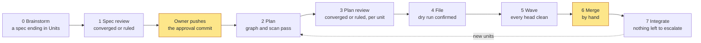
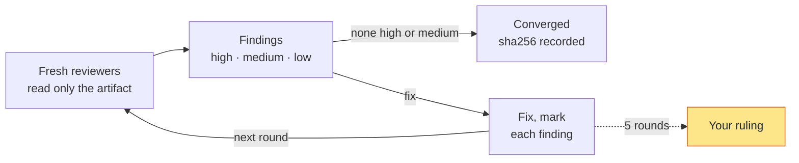
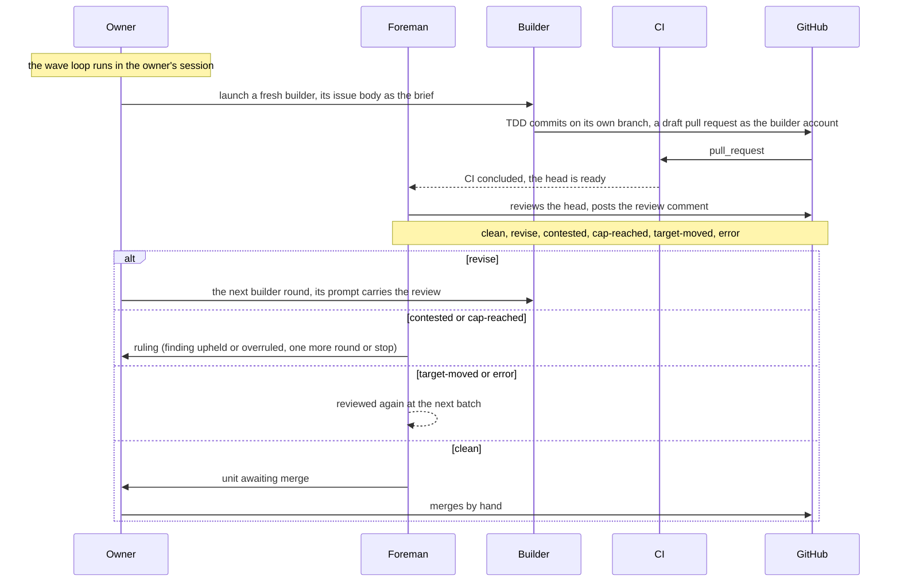

# SuperEGM

<!-- Modified by SuperEGM (gsVAM), 2026: U01's skeleton filled in by U11; U11's README restructured for the public with diagrams; the 1.2 docs sweep (U29); the 1.2.0 release README: what's new, install from GitHub and why, the setup map, the documentation table.; the inaugural public README (1.2): the pitch, the story, the feature tour, the compact review figure. -->

<p align="center"></p>

<h3 align="center">An AI engineering team that ships reviewed pull requests,<br>and can never merge without you.</h3>

<p align="center"><strong>The Super Elephant-Goldfish Model</strong> · one Claude Code plugin, from an idea to merged pull requests</p>

<p align="center">
  <a href="https://github.com/gsVAM/superegm/releases/latest"></a>
  <a href="https://github.com/gsVAM/superegm/actions/workflows/tests.yml"></a>
  
  
</p>

<p align="center"><a href="#what-it-feels-like">What it feels like</a> · <a href="#whats-inside">What's inside</a> · <a href="#install">Install</a> · <a href="#before-the-first-run">Setup</a> · <a href="#your-first-project">First project</a> · <a href="#documentation">Docs</a></p>

> **1.2 is SuperEGM's inaugural public release, open to the world.** Two commands install it from this repository, and it was built by its own workflow.

SuperEGM turns Claude Code into a small, disciplined software team that works in your GitHub repository. You describe an idea. A team of agents brainstorms it with you. Reviewers who have never seen your conversation pick the design apart until it holds. The approved design becomes one GitHub issue per unit of work, and fresh builders work those issues in parallel: test first, each on its own branch, each opening its own pull request. Every pull request is reviewed again, against the design and against CI, before it reaches you.

Then you merge. Only you can.

## Why it exists

Ask one AI session to design, build and check a feature, and three things go wrong:

- **It drifts.** Hours in, the design in its head is no longer the one you agreed on.
- **It grades its own homework.** The session that wrote the code is the worst judge of it.
- **It forgets.** A decision you made before lunch is gone by the evening.

SuperEGM splits the work between two kinds of session:

- The **elephant** is the long-memory session, yours. It brainstorms, drafts, plans, drives the waves and remembers everything. That memory is also why it is biased toward its own intentions.
- The **goldfish** is a fresh, isolated, zero-context session: reviewer, judge, foreman, builder. It sees only the artifact and the evidence attached to its dispatch, so it finds what the elephant can no longer see.

The philosophy:

- Separate remembering from judging.
- Attach evidence, never context.
- Make "clean" a property of bytes at a commit.
- Keep the human on every merge.
- Converge across more than one model vendor, so a verdict is not one vendor agreeing with itself.

## What it feels like

1. **Monday, 9:00.** You open Claude Code in your repository and describe a feature in a paragraph. With `--team`, four agents work the idea with you: a cartographer reads your code, then an architect, a skeptic and an advocate each argue an approach and challenge one another. Out comes a design document that ends in a list of units of work.
2. **9:40.** You type `/superegm:review-spec`. Reviewers who see only the document, never your chat, find the gaps: a missing error path, two sections that disagree, a unit too big to build alone. The spec is fixed and reviewed again until nothing serious is left. You approve it, and its hash is frozen.
3. **10:15.** `/superegm:plan` and `/superegm:file` turn the design into GitHub issues, one per unit. Each issue is a test-first plan a stranger could follow, with the links between units that depend on each other.
4. **10:30.** `/superegm:wave` starts the builders, or you hand the run to the driver and go home. Each builder is a fresh session on its own branch, pushing as a separate GitHub account. A foreman reviews every pull request, re-runs its checks and sends back anything that is not right.
5. **Overnight.** In leave-me-alone mode a panel of judges rules on contested findings instead of you. One question splits the panel, so it waits for you. Your inbox lists it, and you answer with a `**Ruling:**` comment on the issue, from your phone.
6. **Tuesday, 8:00.** You open the live board on the tracking issue. Six pull requests are clean and waiting. You read them and you merge. Nothing merged itself.

## What's inside

### Think it through before anything is built

- **Team brainstorm.** `/superegm:brainstorming --team` (or `brainstorm.team` in the config) runs the brainstorm with four agents. A cartographer maps what your code already has. An architect, a skeptic and an advocate each work one approach in their own context and challenge each other's claims. They run as Claude Code agent teams when those are enabled, and as ordinary subagents otherwise.
- **A spec reviewed by strangers.** A panel of isolated reviewers, each with its own lens (design, readiness, structure, style, comprehension, scope and more), reads the spec round after round. Findings are rated high, medium or low and go back for fixes until nothing high or medium is left. The approval freezes the spec at a sha256, and no builder starts until the base branch carries exactly those bytes.

### A plan you can read on GitHub

- **One issue per unit.** The plan is cut into units, and each unit's issue is its builder's whole brief: the test-first plan, the files it owns and its definition of done. The plan is reviewed against the spec before anything is filed. Dependencies become blocked-by links between issues.
- **Built for parallel waves.** The plan rules keep units off each other's files, so a wave can run several builders at once (`max_in_flight`).
- **The right model for each unit.** Mark a unit `Tier: difficult`, `doable` or `easy`. By default, difficult units get Opus at high effort, easy ones get Sonnet, and doable units get the builder's default model. Every role (builder, reviewer, judge) has its own model and effort, and `superegm doctor` prints them.

### Builders you do not have to trust

- **Fresh, isolated builders.** A builder is a new Claude Code session with an empty profile. It sees its issue, its orders and the rulings on its issue, never your planning conversation. It writes the failing test first, commits on its own branch, and opens a draft pull request as a separate GitHub account that cannot touch your base branch. It loads exactly the plugins and MCP servers you list for builders, and each launch records them.
- **A foreman that checks the work.** Every pull request head gets a foreman, another goldfish. It waits for CI, re-runs the definition-of-done commands itself rather than trusting pasted output, and checks the test delta, so a deleted or weakened test is a high finding. It then reviews the head with the panel, posts one review on the pull request and returns one word: `clean`, `revise`, or `contested` when a finding needs a ruling.
- **Two vendors, not one.** With the optional Codex lane, a GPT reviewer (Astra) sits beside the Claude reviewers on every panel and every judges' panel, so no single model grades its own work.
- **Judges for the hard calls.** In leave-me-alone mode, isolated judges on more than one model rule on contested findings, one question at a time, and a panel that does not converge waits for you.

### See everything, steer from anywhere

- **A live board.** The tracking issue on GitHub carries a table that updates itself on every status pass: each unit's state, review round, pull request, what it waits on, the next action, what its builders cost, and its tier. An illustrative board, trimmed to eight of its ten columns:

  | unit | state | round | PR | waits on | next action | cost | tier |
  | --- | --- | --- | --- | --- | --- | --- | --- |
  | U1 #12 | landed | r2 posted clean | #20 | none | none | 6.84 | doable |
  | U2 #13 | clean | r1 posted clean | #21 | none | await-merge | 3.10 | easy |
  | U3 #14 | active | none | #22 | ci | foreman dispatch | 2.45 | difficult |
  | U4 #15 | pending | r5 posted cap-reached | #23 | q4 | decision 2 | 11.37 | doable |

- **One inbox.** `/superegm:inbox` lists only what needs you: in this repository, or with `--all` across every repository you registered. If you write an executable `~/.superegm/notify`, it receives each new item, so a phone notification is one script away.
- **Rule from your phone.** A `**Ruling:**` comment on a unit's issue, from an owner, is a ruling. You never have to open a terminal to unblock a unit.
- **Outside reviews count.** A review from a colleague or a review bot on a builder's pull request, or on the spec's own pull request, is ingested as findings and enters the same loop.
- **Accept early.** When only mediums and lows remain, the review says so, and you can accept without waiting out five rounds.

### Leave it running

- **Leave-me-alone mode.** Add `--leavemealone` and the judges rule at every decision point. You wake up to merge-ready draft pull requests.
- **The driver.** `/superegm:driver` installs a launchd or systemd timer that keeps your registered projects moving, one wave pass at a time, while you are away. It runs without permission prompts, so read the caution under [How a wave works](#how-a-wave-works) first.
- **The watchdog.** A builder with no new commit for 30 minutes (`builder.stall_minutes`) is reported as stalled, so it is not left quietly burning time.

### A human on every merge

Builders push as their own account and open draft pull requests. A repository ruleset lets only you update the base branch. The foreman never merges or approves, and neither does the driver. SuperEGM brings you work that is reviewed, tested and clean, and the merge stays yours.

## Built by SuperEGM

SuperEGM 1.2 was built by SuperEGM. Its [design](https://github.com/gsVAM/superegm/blob/main/docs/specs/2026-11-03-superegm-design.md) was brainstormed and reviewed, then cut into 15 units, filed as issues #80 to #94 under tracking issue [#79](https://github.com/gsVAM/superegm/issues/79). Each unit was built by a fresh builder, reviewed head by head by isolated reviewers from two vendors, and merged by hand. The suite stands at 2,734 tests.

## The workflow at a glance

Eight phases, one typed skill each, nothing chains. The yellow steps are the human's.



The approval commit is the one human step between phases 1 and 5: `launch` refuses the first wave until the spec on the base branch hashes to the approval. Integrate may append new units to the spec; they go through plan, plan review, file and wave again.

## Install

**You need** Claude Code, `git`, the GitHub CLI (`gh`) logged in, and `python3` (CI runs 3.11). That is the whole runtime: the helper is standard-library Python and every store is plain JSON on your disk.

**Why install from the GitHub repository.** This repository is its own Claude Code marketplace: `marketplace add gsVAM/superegm` points Claude Code at it, and `plugin install` takes the latest tagged release. Every release is cut from a reviewed, merged pull request, tagged and never moved, and ships a ZIP with its `SHA256SUMS` ([docs/releases.md](docs/releases.md)). So what you install is exactly what the tag says, and `claude plugin update superegm@superegm` moves you to the next one. Your projects live in their own GitHub repositories, too: SuperEGM files its plan as issues, its builders open pull requests there, and your merge is the only way code reaches your base branch.

Disable the two plugins SuperEGM absorbs first. Their skills have the same names and would fight over which one runs. Then install from the marketplace:

```sh
claude plugin disable egm@egm-astra
claude plugin disable superpowers@claude-plugins-official
```

```sh
claude plugin marketplace add gsVAM/superegm
claude plugin install superegm@superegm
```

Optional, and recommended: the second vendor. With [claudex-loop](https://github.com/chaseai-yt/claudex-loop) and a logged-in Codex CLI, a GPT reviewer (Astra) joins every review panel and every judges' panel, so no single model grades its own work:

```sh
claude plugin marketplace add chaseai-yt/claudex-loop
claude plugin install claudex-loop@claudex-loop
codex login
```

Without it, or with `"astra": {"enabled": false}` in `.superegm/config.json`, the lane records `not run` and reviews run Claude-only. What leaves your machine, and to whom, is in [docs/privacy.md](docs/privacy.md).

The workflow is in [docs/getting_started.md](docs/getting_started.md); the platform facts in [docs/claude.md](docs/claude.md).

## Before the first run

<!-- superegm:u11 -->

**Why this is on GitHub, and why it takes a few minutes.** SuperEGM works where your code already lives. The plan becomes GitHub issues you can read, builders work on branches and open draft pull requests, CI runs on every push, and rulings can be comments. What it asks you to set up once is the safety it relies on: a second login so a builder can never be you, a ruleset so nothing but your merge reaches the base branch, and a clean profile so a builder sees its orders and nothing else.

| Step | What | Why |
|------|------|-----|
| 1 | The builder account | Builders push as a separate login with a token scoped to this repository and without `workflow`, so they can never update the base branch or the CI that judges them |
| 2 | An empty builder profile | A builder starts fresh: no plugins and no `CLAUDE.md` it did not get from its orders |
| 3 | A ruleset on the base branch | Only owners update it; unit branches cannot be force-pushed or deleted |
| 4 | CI on `pull_request` | `clean` means CI green on the head; no CI means nothing is ever clean |
| 5 | Commit the config | Every session and every builder reads the same `.superegm/config.json` |
| 6 | Review from a profile without `SubagentStart` hooks | Such a hook reaches every goldfish, and a goldfish is meant to see the artifact and nothing else |
| 7–9 | Builder tooling, the driver, keeping the machine awake | Only when you want them: plugins for builders, waves while you are away, a laptop that does not sleep mid-wave |


Six things need a human once, before the first wave, and three more as you need them: the builder's own tooling (step 7) and the driver's unattended waves (steps 8 and 9). `superegm init` (run by the first typed skill when `.superegm/config.json` is missing) writes the config and prints the first five by-hand steps; steps 6 to 9 are yours to remember:

1. Create the **builder account**: a second GitHub login, a machine account the owner controls (one is allowed per person), added to the repository as a collaborator with Write. Its token is a fine-grained personal access token when the repository belongs to an organization the builder account is a member of (resource owner that organization, repository access limited to this repository, permissions Contents read and write, Pull requests read and write, Issues read and write, Metadata read, no Workflows permission, expiration 90 days), and otherwise a classic token (a fine-grained token's resource owner is the holder's own account or an organization it belongs to, so a collaborator on a personal account's repository has no such token) with the `repo` scope and without `workflow`; either way a builder push that touches `.github/workflows` is refused by GitHub itself, and an organization's token policies may block either kind, which the owner checks. Put the token in `SUPEREGM_BUILDER_TOKEN` (config key `builder.gh_token_env`) in the shell that runs the wave, never in the repository or the config. Builders push and open draft pull requests as that account and can never update the base branch.

   Or register a **GitHub App** instead, the recommended path for an organization (the machine account is the quick path for a personal repository): a name, no webhook, visibility `Only on this account` (a public App is installable by anyone, and the key would mint for them), repository permissions `contents: write`, `pull_requests: write`, `issues: write`, `metadata: read` and no other (`doctor` checks exactly these four), installed on this repository (the installation may reach other repositories too: every token is minted for this repository alone, and `doctor` checks that the token reaches no other); note the App ID and slug, generate a private key and keep the `.pem` file outside the repository at the path the variable `SUPEREGM_APP_KEY` names (config key `builder.app.private_key_env`); set `builder.app` to `{"app_id": <id>, "slug": "<slug>", "private_key_env": "SUPEREGM_APP_KEY"}` and leave `SUPEREGM_BUILDER_TOKEN` unset, one identity per repository. Builders then push and comment as `<slug>[bot]` under one-hour tokens minted per call; no token is ever written anywhere.

2. Create the builder's empty profile at `config.builder.profile_dir`: no hooks, no plugins and no `CLAUDE.md`, only the login (`CLAUDE_CONFIG_DIR=<profile_dir> claude`, then `/login`, then exit) and a `settings.json` with `"syncClaudeAiPlugins": false` and `"disableClaudeAiConnectors": true`, set before the login, so the account's plugins are not synced into the profile on every start (Claude Code 2.1.273 or later) and its claude.ai connectors are not loaded; `launch-builder` refuses anything else (the files Claude Code writes on its own, `plugins/installed_plugins.json` with no entry, `known_marketplaces.json`, its default marketplace clones under `marketplaces/`, `store/`, are not plugins; the plugins your organization's claude.ai policy installs, `scope: managed` in `installed_plugins.json`, are policy you cannot refuse from a profile: they are not refused, and every launch records them in the store's `launches/<unit>_r<n>_plugins.json`).
3. Set the branch protection of design section 11 on the base branch: restrict updates to the owner, the logins in `config.owners` (`init` writes your own): a classic restriction naming a non-empty subset of them, or a ruleset whose bypass names neither the builder account's role nor a team other than `config.owner_team`, which the builder account is outside; block force-push and deletion on `superegm/**` with a repository ruleset whose target pattern is exactly `refs/heads/superegm/**/*` (GitHub's ruleset matcher takes `refs/heads/superegm/**` as matching no branch, and `doctor` then reports `superegm/**` unprotected), the only form `launch` reads for that pattern. `launch` reads the protection and refuses the first wave without it.
4. Add a workflow triggered on `pull_request`, so every builder head gets CI: CI is the foreman's evidence.
5. Commit `.superegm/config.json`; `approve-spec` commits it with the spec.
6. Run reviews from a profile without SubagentStart hooks: such hooks in the owner's own profile reach adapter subagents, and every dispatch record carries what the goldfish reported seeing.
7. Configure the builder's tooling, if it needs any: list the plugins in `config.builder.plugins` (each installed once into your own profile and disabled there) and the MCP servers in `config.builder.mcp`; every launch loads exactly those and records them, with each plugin's hook events, in `launches/<unit>_r<n>_plugins.json`. To let builders delegate, add `Agent` to `config.builder.allowed_tools` (absent by default): a builder may then spawn the platform's default subagents under its own allow-list, budgeted in its orders at `builder.max_subagent_calls` (12), a budget the helper does not enforce.
8. For the driver, write `~/.superegm/env` (`KEY=value` lines, mode 0600: `PATH`, `CLAUDE_CONFIG_DIR` naming a profile without SubagentStart hooks, and `SUPEREGM_APP_KEY` or `SUPEREGM_BUILDER_TOKEN`; the driver's sessions run unattended with `bypassPermissions`, no allow-list and no prompt, under that credential), then type `/superegm:driver install` (installs the timer with `superegm driver install`; re-typed after every plugin update) and `/superegm:driver register` (runs `superegm register`) from each handoff's worktree; the skill runs both under a `driver` card, without which the helper refuses them. On Linux, also run `loginctl enable-linger` so the timer runs while you are logged out.
9. Keep the machine awake while the driver runs (`pmset`, or `caffeinate`): `doctor` prints the `sleep:` setting. Optionally write `~/.superegm/notify`, an executable outside every repository that gets the new inbox lines on its stdin.

Then run `superegm doctor` before the first wave: one line per prerequisite, `ok` or the refusal `launch` would give, and no run card.

## Your first project

1. Open Claude Code in the repository and describe the idea. `/superegm:brainstorming` is auto-invoked and drafts a spec under `docs/specs/` that ends in `## Units`. With `--team` (or `config.brainstorm.team`) it brainstorms in team mode: a cartographer, an architect, a skeptic and an advocate, falling back to subagents when agent teams are off.
2. `/superegm:review-spec <spec>`: isolated reviewers go round until the spec converges. Approve it, then push the approval commit to the base branch.
3. `/superegm:plan <spec>`, then `/superegm:review-plan <spec>`: one TDD plan per unit, each reviewed against the spec.
4. `/superegm:file <spec>`: confirm the dry run; one GitHub issue per unit, with blocked-by links.
5. `/superegm:wave <spec>`: builders build, foremen review, and you merge the clean draft pull requests by hand. Merge, then type it again until every unit has landed.
6. `/superegm:integrate <spec>`: the spec is reviewed against everything merged; the handoff closes when nothing is left to escalate.

Add `--leavemealone` to a skill (or set `"mode": "leavemealone"` in `.superegm/config.json`) and the judge panel rules at every decision point instead of you; merging stays yours.

## How a review works

One review loop serves the spec, every plan and every pull request head. Each round, every reviewer on the panel is a goldfish: a fresh, isolated session that sees only the artifact, the standards for its kind and, from round 2, the previous round's findings with the fixes marked. The panel is fixed when the review opens and every reviewer runs concurrently. At the cap of five rounds the owner rules: one more round, accept, or stop.



Lows never block. A high or medium finding that is contested or declined needs the owner's word in normal mode, and on a pull request head the cap ruling is one more round or stop, never accept. In leavemealone-mode the judge panel (isolated judges on more than one model, converging per question) gives those rulings instead, and a panel that does not converge waits for the owner.

Every external review is ingested as findings: a review on a builder's pull request, and from 1.2 the spec's own pull request (`review ingest --pr`, with the pull request's number), enters the same loop. The owner rules with one `**Ruling:**` comment, from a phone if need be. Below the cap, when only mediums and lows stand, `review status` prints an `acceptable:` line and the owner may accept; the journal then records it as accepted before the cap, and on a pull request head the wave asks it as `decision open --point 5` (accept or revise).

## How a wave works

`/superegm:wave` runs a driver loop in your own session. It launches a builder per ready unit (up to `max_in_flight`), watches the pull requests, and dispatches a foreman for every head once CI has concluded. The foreman is a goldfish too: it reviews the head with the panel, posts one review on the pull request, and returns one word.



Clean means CI green, every definition-of-done item met, no unsettled high or medium finding, test-first order checked and no unruled deviation. The foreman never merges, never approves and never launches a session; `launch` refuses the first wave until the base branch carries the protection from the by-hand steps.

The foreman re-runs every DoD `Run` item on the head itself rather than trusting the pasted output, and checks the test delta: a test removed or weakened is a high finding only the owner can allow. A builder runs on its unit's tier (`builder.tiers` for a difficult or an easy unit, `builder.model` and `builder.effort` for a doable one), loads the plugins of `config.builder.plugins` and the servers of `config.builder.mcp` alone, and records them in `launches/<unit>_r<n>_plugins.json`. The review goldfish run on `reviewers.model` at `reviewers.effort` (`opus` / `xhigh` by default; `SUPEREGM_GOLDFISH_MODEL` and `SUPEREGM_GOLDFISH_EFFORT` override them for a session), each judge on its `judges.members` model and effort, and the foreman's Astra lane at `astra.heads_effort` (`high`); `doctor` prints one `model:` line per role. A running builder with no newer commit of its own for `builder.stall_minutes` is reported stalled, comments or not. The tracking issue carries a live board between `<!-- superegm:board -->` and `<!-- /superegm:board -->`, and `close` closes the tracking issue when the handoff ends with every unit landed.

The fleet layer runs waves while you are away. `/superegm:inbox` lists only what needs you in the current repository's store, and with `--all` across every registered store; `~/.superegm/notify`, if you write it, is told of each new line. `/superegm:driver` installs a timer (`superegm driver install`) that types `wave --leavemealone` for one open handoff at a time per store in the environment of `~/.superegm/env`, over the stores `superegm register` listed; keep the machine awake (`caffeinate`). That session runs with `--permission-mode bypassPermissions`, no allow-list and no prompt, under the credential the env file names, so install the driver only on a machine and for repositories you would let a session act on alone. The driver never merges.

## The eight phases

| # | Phase | Skill | Gate |
| --- | --- | --- | --- |
| 0 | Brainstorm | `/superegm:brainstorming` (auto-invoked) | the owner's opt-in; a spec ending in `## Units` |
| 1 | Spec review | `/superegm:review-spec <spec>` | converged or ruled; the approval freezes the spec at a sha256 |
| 2 | Plan | `/superegm:plan <spec>` | `graph` and `scan` pass |
| 3 | Plan review | `/superegm:review-plan <spec>` | converged or ruled, per unit |
| 4 | File | `/superegm:file <spec>` | a dry run the owner confirms; `verify` reads back |
| 5 | Wave | `/superegm:wave <spec>` | per unit: a clean head, contested findings ruled, no regressions |
| 6 | Merge | the owner | nothing is merged by a machine |
| 7 | Integrate | `/superegm:integrate <spec>` | nothing left to escalate; `--close` gives a handoff up |

In the plan phase each unit may carry a `Tier:` row (`difficult`, `doable` or `easy`) that picks its builder's model and effort from `builder.tiers`; a unit without one builds as doable.

One skill per phase, nothing chains; the owner pushes the approval commit between phases 1 and 5. With `--leavemealone` (or `"mode": "leavemealone"` in the config) the judge panel rules at every decision point and the owner wakes to merge-ready draft pull requests.

## Skills

- `/superegm:brainstorming`: turn an idea into a written design that ends in `## Units`
- `/superegm:draft`: draft a spec from a brief when brainstorming was skipped
- `/superegm:review-spec`: the adversarial spec review, run to convergence
- `/superegm:plan`: cut the approved spec into TDD-shaped build units
- `/superegm:review-plan`: review the plan against the spec before anything is filed
- `/superegm:orient`: copy what the repository says about a unit into the store, an extractor that never summarizes
- `/superegm:file`: file the confirmed plan as GitHub issues
- `/superegm:wave`: launch, review and land a wave of units
- `/superegm:inbox`: list what needs the owner across every registered store
- `/superegm:driver`: install, inspect or reset the timer that runs waves unattended, and register a store
- `/superegm:interrupt`: pause a running wave at the next safe point
- `/superegm:clean`: remove what a wave left behind locally
- `/superegm:finishing-a-development-branch`: finish a branch outside a wave, the PR as the owner
- `/superegm:integrate`: review the spec against everything merged and close the handoff
- `/superegm:judges`: run the judge panel over a question file (advisory when typed)
- `/superegm:test-driven-development`: red, green, commit on a filed unit's branch
- `/superegm:systematic-debugging`: find the root cause before fixing
- `/superegm:verification-before-completion`: prove it works before calling it done
- `/superegm:writing-skills`: write and test a skill for this plugin
- `/superegm:using-superegm`: the dispatcher every session reads first
- `/superegm:drift-report`: check the code against the designs after `integrate`

## Credits and lineage

SuperEGM is built on five projects.

- Google's [Elephant-and-Goldfish Model](https://github.com/google/elephant-goldfish-model) (Apache-2.0) gives the orchestration: deep-context elephants draft and zero-context goldfish stress-test. The adversarial gate before any code, the handoff into issues, the waves and the foreman all come from it.
- gsVAM's [EGM Astra fork](https://github.com/gsVAM/elephant-goldfish-model) 0.2.1, built on the upstream, gives the Astra lane and the panel presets SuperEGM inherits.
- Jesse Vincent's [superpowers](https://github.com/obra/superpowers) 7.0.0 (MIT) gives the unit of work: brainstorming, test-driven development, systematic debugging, verification before completion and writing skills.
- chaseai-yt's [claudex-loop](https://github.com/chaseai-yt/claudex-loop) gives the cross-provider lane: it runs GPT-model reviewers and judges headlessly, which SuperEGM uses for Astra reviews and the judge panel.
- [graphify](https://github.com/Graphify-Labs/graphify) by Graphify Labs gives orient its engine: a local, deterministic AST pass over code, a semantic pass over documents, and a knowledge graph with every edge explained, which `orient` projects per unit for builders and reviewers.

SuperEGM aims to unite these workflows under one plugin with cross-provider adversarial review: EGM's gates around superpowers' unit of work, and every review and judge panel able to seat reviewers from more than one model vendor through claudex-loop, so a converged verdict is not one vendor agreeing with itself. When the cross-provider lane is absent the panel degrades to Claude-only judges and says so in the record.

SuperEGM runs in Claude Code only; there is no Codex host.

## Documentation

| Document | Read it when |
|----------|--------------|
| [Getting started](docs/getting_started.md) | You are installing, setting up a repository, or want the phases and modes in one place |
| [Claude Code](docs/claude.md) | You want the platform facts: adapters, hooks, isolation, what a builder can and cannot do |
| [FAQ](docs/faq.md) | You have a question about merging, the builder account, leaving it running, or reviews that do not converge |
| [Privacy](docs/privacy.md) | You need to know what leaves your machine, and to whom |
| [Releases](docs/releases.md) | You are cutting or verifying a release |
| [The design](https://github.com/gsVAM/superegm/blob/main/docs/specs/2026-11-03-superegm-design.md) | You want the whole design, every unit and every amendment |
| [Index](docs/index.md) | You want everything else, including the shared runtime resources |

## Licence

The full list of files carrying a notice:

**Licence.** Apache-2.0 (`LICENSE`) for the EGM-derived files and SuperEGM's own, MIT (`LICENSE-MIT`) for the superpowers-derived files. Every file changed from its source carries a notice naming the change, in the source's own form. The Apache files with a notice: `.claude-plugin/agents/change-review.md`, `.claude-plugin/agents/codebase-details.md`, `.claude-plugin/agents/comprehension.md`, `.claude-plugin/agents/design.md`, `.claude-plugin/agents/foreman.md`, `.claude-plugin/agents/readiness.md`, `.claude-plugin/agents/structural.md`, `.claude-plugin/agents/style.md`, `.claude-plugin/agents/zoom-out.md`, `.github/workflows/tests.yml`, `README.md`, `agents/change-review.md`, `agents/codebase-details.md`, `agents/comprehension.md`, `agents/design.md`, `agents/readiness.md`, `agents/structural.md`, `agents/style.md`, `agents/zoom-out.md`, `docs/claude.md`, `docs/faq.md`, `docs/getting_started.md`, `docs/index.md`, `docs/privacy.md`, `docs/releases.md`, `resources/astra_lane.md`, `resources/document_standards/handoff-standard.md`, `resources/review_panels.md`, `scripts/pack_plugin.py`, `scripts/prepare_release.py`, `skills/draft/SKILL.md`, `skills/draft/references/design_doc.md`, `skills/draft/test_scenarios.yaml`, `skills/drift-report/SKILL.md`, `skills/drift-report/test_scenarios.yaml`, `skills/file/SKILL.md`, `skills/judges/references/astra_judge.md`, `skills/plan/SKILL.md`, `skills/plan/references/handoff_config.md`, `skills/plan/references/handoff_plan.md`, `skills/plan/references/issue_template.md`, `skills/plan/scripts/superegm.py`, `skills/plan/scripts/superegm/__init__.py`, `skills/plan/scripts/superegm/apply.py`, `skills/plan/scripts/superegm/approve_spec.py`, `skills/plan/scripts/superegm/body.py`, `skills/plan/scripts/superegm/collect.py`, `skills/plan/scripts/superegm/decide.py`, `skills/plan/scripts/superegm/dry_run.py`, `skills/plan/scripts/superegm/gate.py`, `skills/plan/scripts/superegm/graph.py`, `skills/plan/scripts/superegm/launch.py`, `skills/plan/scripts/superegm/prepare.py`, `skills/plan/scripts/superegm/record_launch.py`, `skills/plan/scripts/superegm/scan.py`, `skills/plan/scripts/superegm/status.py`, `skills/plan/scripts/superegm/verify.py`, `skills/plan/test_scenarios.yaml`, `skills/review-plan/SKILL.md`, `skills/review-plan/test_scenarios.yaml`, `skills/review-spec/SKILL.md`, `skills/review-spec/references/resolve.md`, `skills/review-spec/references/review_loop.md`, `skills/review-spec/test_scenarios.yaml`, `skills/wave/SKILL.md`, `skills/wave/references/foreman_brief.md`, `skills/wave/test_scenarios.yaml`, `tests/integration/test_claude.py`, `tests/unit/conftest.py`, `tests/unit/test_astra_fork.py`, `tests/unit/test_events.py`, `tests/unit/test_file.py`, `tests/unit/test_harnesses.py`, `tests/unit/test_helper.py`, `tests/unit/test_packaging.py`, `tests/unit/test_plan.py`, `tests/unit/test_releases.py`, `tests/unit/test_review.py`, `tests/unit/test_review_plan.py`. The superpowers files with a notice: `hooks/session-start`, `skills/brainstorming/SKILL.md`, `skills/finishing-a-development-branch/SKILL.md`, `skills/plan/references/writing_plans.md`, `skills/systematic-debugging/SKILL.md`, `skills/test-driven-development/SKILL.md`, `skills/using-superegm/SKILL.md`, `skills/using-superegm/references/claude-code-tools.md`, `skills/verification-before-completion/SKILL.md`, `skills/wave/references/builder_orders.md`, `skills/writing-skills/SKILL.md`, `skills/writing-skills/references/skill_discovery_optimization.md`, `tests/unit/test_builders.py`, `tests/unit/test_effects.py`.


---

Built by its own workflow. 1.1: 13 units in 6 waves. 1.2: 15 more units, each built by a fresh builder, reviewed by isolated goldfish and merged by its owner; 2734 tests. The documentation index is [docs/index.md](docs/index.md).
