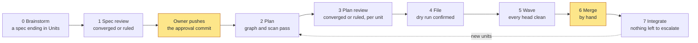
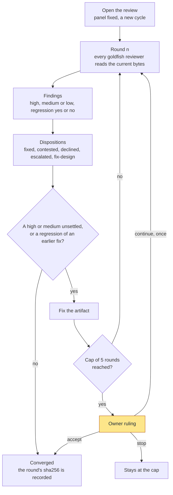
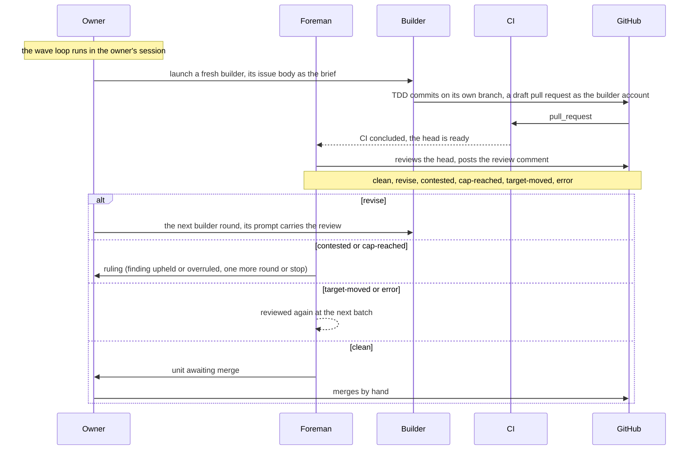

# SuperEGM

<!-- Modified by SuperEGM (gsVAM), 2026: U01's skeleton filled in by U11; U11's README restructured for the public with diagrams. -->

SuperEGM is one Claude Code plugin that takes an idea to merged pull requests. It brainstorms the design with you, has isolated reviewers review that design before anything is planned, cuts the approved design into units, files one GitHub issue per unit, and launches a fresh, isolated builder per unit that commits test-first and opens a draft pull request. A foreman reviews every pull request head with CI as its evidence. The human approves the design, rules when a review asks, and merges. The spec is not the plan: the spec is the design document, and the plan belongs to the GitHub issue, one per unit.

It is superpowers' unit of work (a brainstormed design, a TDD-shaped plan per unit) inside EGM's orchestration (isolated reviewers, an adversarial gate before anything is written, a dependency graph cut into waves, a foreman per unit reviewing every PR head with CI as evidence, a merge that stays human).

## Why

- The spec is reviewed before anything is planned. Reviewers who see only the spec find the holes while they are cheap, and the approval freezes the spec at a sha256.
- Every unit is a TDD plan a fresh builder can follow alone. A builder's brief is its issue body, the builder orders and the rulings on its issue; it never sees the planning conversation.
- Nothing merges without a human. Builders push and open draft pull requests as their own account; only the owner can update the base branch.

## The workflow at a glance

Eight phases, one typed skill each, nothing chains. The yellow steps are the human's.



The approval commit is the one human step between phases 1 and 5: `launch` refuses the first wave until the spec on the base branch hashes to the approval. Integrate may append new units to the spec; they go through plan, plan review, file and wave again.

## Install

Disable the two plugins SuperEGM absorbs first, then install from the marketplace:

```sh
claude plugin disable egm@egm-astra
claude plugin disable superpowers@claude-plugins-official
```

```sh
claude plugin marketplace add gsVAM/superegm
claude plugin install superegm@superegm
```

The workflow is in [docs/getting_started.md](docs/getting_started.md); the platform facts in [docs/claude.md](docs/claude.md).

## Before the first run

<!-- superegm:u11 -->

Six things need a human once, before the first wave. `superegm init` (run by the first typed skill when `.superegm/config.json` is missing) writes the config and prints these by-hand steps:

1. Create the **builder account**: its own GitHub login with write access to the repository, and put a token for it in `SUPEREGM_BUILDER_TOKEN` (config key `builder.gh_token_env`). Builders push and open draft pull requests as that account and never merge.
2. Create the builder's empty profile at `config.builder.profile_dir`: no hooks, no plugins and no `CLAUDE.md`, only the login; `launch-builder` refuses anything else.
3. Set the branch protection of design section 11 on the base branch: restrict updates to the owner with no bypass for the builder account's role (classic or ruleset); block force-push and deletion on `superegm/**` with a repository ruleset, the only form `launch` reads for that pattern. `launch` reads the protection and refuses the first wave without it.
4. Add a workflow triggered on `pull_request`, so every builder head gets CI: CI is the foreman's evidence.
5. Commit `.superegm/config.json`; `approve-spec` commits it with the spec.
6. Run reviews from a profile without SubagentStart hooks: such hooks in the owner's own profile reach adapter subagents, and every dispatch record carries what the goldfish reported seeing.

## Your first project

1. Open Claude Code in the repository and describe the idea. `/superegm:brainstorming` is auto-invoked and drafts a spec under `docs/specs/` that ends in `## Units`.
2. `/superegm:review-spec <spec>`: isolated reviewers go round until the spec converges. Approve it, then push the approval commit to the base branch.
3. `/superegm:plan <spec>`, then `/superegm:review-plan <spec>`: one TDD plan per unit, each reviewed against the spec.
4. `/superegm:file <spec>`: confirm the dry run; one GitHub issue per unit, with blocked-by links.
5. `/superegm:wave <spec>`: builders build, foremen review, and you merge the clean draft pull requests by hand. Merge, then type it again until every unit has landed.
6. `/superegm:integrate <spec>`: the spec is reviewed against everything merged; the handoff closes when nothing is left to escalate.

Add `--leavemealone` to a skill (or set `"mode": "leavemealone"` in `.superegm/config.json`) and the judge panel rules at every decision point instead of you; merging stays yours.

## How a review works

One review loop serves the spec, every plan and every pull request head. Each round, every reviewer on the panel is a goldfish: a fresh, isolated session that sees only the artifact, the standards for its kind and, from round 2, the previous round's findings with the fixes marked. The panel is fixed when the review opens and every reviewer runs concurrently.



Lows never block. A high or medium finding that is contested or declined needs the owner's word in normal mode, and on a pull request head the cap ruling is one more round or stop, never accept. In leavemealone-mode the judge panel (isolated judges on more than one model, converging per question) gives those rulings instead, and a panel that does not converge waits for the owner.

## How a wave works

`/superegm:wave` runs a driver loop in your own session. It launches a builder per ready unit (up to `max_in_flight`), watches the pull requests, and dispatches a foreman for every head once CI has concluded. The foreman is a goldfish too: it reviews the head with the panel, posts one review on the pull request, and returns one word.



Clean means CI green, every definition-of-done item met, no unsettled high or medium finding, test-first order checked and no unruled deviation. The foreman never merges, never approves and never launches a session; `launch` refuses the first wave until the base branch carries the protection from the by-hand steps.

## The eight phases

| # | Phase | Skill | Gate |
| --- | --- | --- | --- |
| 0 | Brainstorm | `/superegm:brainstorming` (auto-invoked) | the owner's opt-in; a spec ending in `## Units` |
| 1 | Spec review | `/superegm:review-spec <spec>` | converged or ruled; the approval freezes the spec at a sha256 |
| 2 | Plan | `/superegm:plan <spec>` | `graph` and `scan` pass |
| 3 | Plan review | `/superegm:review-plan <spec>` | converged or ruled, per unit |
| 4 | File | `/superegm:file <spec>` | a dry run the owner confirms; `verify` reads back |
| 5 | Wave | `/superegm:wave <spec>` | per unit: a clean head, contested findings ruled, no regressions |
| 6 | Merge | the owner | nothing is merged by a machine |
| 7 | Integrate | `/superegm:integrate <spec>` | nothing left to escalate; `--close` gives a handoff up |

One skill per phase, nothing chains; the owner pushes the approval commit between phases 1 and 5. With `--leavemealone` (or `"mode": "leavemealone"` in the config) the judge panel rules at every decision point and the owner wakes to merge-ready draft pull requests.

## Skills

- `/superegm:brainstorming`: turn an idea into a written design that ends in `## Units`
- `/superegm:draft`: draft a spec from a brief when brainstorming was skipped
- `/superegm:review-spec`: the adversarial spec review, run to convergence
- `/superegm:plan`: cut the approved spec into TDD-shaped build units
- `/superegm:review-plan`: review the plan against the spec before anything is filed
- `/superegm:orient`: copy what the repository says about a unit into the store, an extractor that never summarizes
- `/superegm:file`: file the confirmed plan as GitHub issues
- `/superegm:wave`: launch, review and land a wave of units
- `/superegm:interrupt`: pause a running wave at the next safe point
- `/superegm:clean`: remove what a wave left behind locally
- `/superegm:finishing-a-development-branch`: finish a branch outside a wave, the PR as the owner
- `/superegm:integrate`: review the spec against everything merged and close the handoff
- `/superegm:judges`: run the judge panel over a question file (advisory when typed)
- `/superegm:test-driven-development`: red, green, commit on a filed unit's branch
- `/superegm:systematic-debugging`: find the root cause before fixing
- `/superegm:verification-before-completion`: prove it works before calling it done
- `/superegm:writing-skills`: write and test a skill for this plugin
- `/superegm:using-superegm`: the dispatcher every session reads first
- `/superegm:drift-report`: check the code against the designs after `integrate`

## Credits and lineage

SuperEGM is built on four projects.

- Google's [Elephant-and-Goldfish Model](https://github.com/google/elephant-goldfish-model) (Apache-2.0) gives the orchestration: deep-context elephants draft and zero-context goldfish stress-test. The adversarial gate before any code, the handoff into issues, the waves and the foreman all come from it.
- gsVAM's [EGM Astra fork](https://github.com/gsVAM/elephant-goldfish-model) 0.2.1, built on the upstream, gives the Astra lane and the panel presets SuperEGM inherits.
- Jesse Vincent's [superpowers](https://github.com/obra/superpowers) 7.0.0 (MIT) gives the unit of work: brainstorming, test-driven development, systematic debugging, verification before completion and writing skills.
- chaseai-yt's [claudex-loop](https://github.com/chaseai-yt/claudex-loop) gives the cross-provider lane: it runs GPT-model reviewers and judges headlessly, which SuperEGM uses for Astra reviews and the judge panel.

SuperEGM aims to unite these workflows under one plugin with cross-provider adversarial review: EGM's gates around superpowers' unit of work, and every review and judge panel able to seat reviewers from more than one model vendor through claudex-loop, so a converged verdict is not one vendor agreeing with itself. When the cross-provider lane is absent the panel degrades to Claude-only judges and says so in the record.

SuperEGM runs in Claude Code only; there is no Codex host.

## Licence

The full list of files carrying a notice:

**Licence.** Apache-2.0 (`LICENSE`) for the EGM-derived files and SuperEGM's own, MIT (`LICENSE-MIT`) for the superpowers-derived files. Every file changed from its source carries a notice naming the change, in the source's own form. The Apache files with a notice: `.claude-plugin/agents/change-review.md`, `.claude-plugin/agents/codebase-details.md`, `.claude-plugin/agents/comprehension.md`, `.claude-plugin/agents/design.md`, `.claude-plugin/agents/foreman.md`, `.claude-plugin/agents/readiness.md`, `.claude-plugin/agents/structural.md`, `.claude-plugin/agents/style.md`, `.claude-plugin/agents/zoom-out.md`, `.github/workflows/tests.yml`, `README.md`, `agents/change-review.md`, `agents/codebase-details.md`, `agents/comprehension.md`, `agents/design.md`, `agents/readiness.md`, `agents/structural.md`, `agents/style.md`, `agents/zoom-out.md`, `docs/claude.md`, `docs/faq.md`, `docs/getting_started.md`, `docs/index.md`, `docs/privacy.md`, `docs/releases.md`, `resources/document_standards/handoff-standard.md`, `resources/review_panels.md`, `scripts/pack_plugin.py`, `scripts/prepare_release.py`, `skills/draft/SKILL.md`, `skills/draft/references/design_doc.md`, `skills/draft/test_scenarios.yaml`, `skills/drift-report/SKILL.md`, `skills/drift-report/test_scenarios.yaml`, `skills/file/SKILL.md`, `skills/judges/references/astra_judge.md`, `skills/plan/SKILL.md`, `skills/plan/references/handoff_plan.md`, `skills/plan/references/issue_template.md`, `skills/plan/scripts/superegm.py`, `skills/plan/scripts/superegm/__init__.py`, `skills/plan/scripts/superegm/apply.py`, `skills/plan/scripts/superegm/approve_spec.py`, `skills/plan/scripts/superegm/body.py`, `skills/plan/scripts/superegm/collect.py`, `skills/plan/scripts/superegm/decide.py`, `skills/plan/scripts/superegm/dry_run.py`, `skills/plan/scripts/superegm/gate.py`, `skills/plan/scripts/superegm/graph.py`, `skills/plan/scripts/superegm/launch.py`, `skills/plan/scripts/superegm/prepare.py`, `skills/plan/scripts/superegm/record_launch.py`, `skills/plan/scripts/superegm/scan.py`, `skills/plan/scripts/superegm/status.py`, `skills/plan/scripts/superegm/verify.py`, `skills/plan/test_scenarios.yaml`, `skills/review-plan/SKILL.md`, `skills/review-plan/test_scenarios.yaml`, `skills/review-spec/SKILL.md`, `skills/review-spec/references/resolve.md`, `skills/review-spec/references/review_loop.md`, `skills/review-spec/test_scenarios.yaml`, `skills/wave/SKILL.md`, `skills/wave/references/foreman_brief.md`, `skills/wave/test_scenarios.yaml`, `tests/integration/test_claude.py`, `tests/unit/conftest.py`, `tests/unit/test_astra_fork.py`, `tests/unit/test_events.py`, `tests/unit/test_file.py`, `tests/unit/test_harnesses.py`, `tests/unit/test_helper.py`, `tests/unit/test_packaging.py`, `tests/unit/test_plan.py`, `tests/unit/test_releases.py`, `tests/unit/test_review.py`, `tests/unit/test_review_plan.py`. The superpowers files with a notice: `hooks/session-start`, `skills/brainstorming/SKILL.md`, `skills/finishing-a-development-branch/SKILL.md`, `skills/plan/references/writing_plans.md`, `skills/systematic-debugging/SKILL.md`, `skills/test-driven-development/SKILL.md`, `skills/using-superegm/SKILL.md`, `skills/using-superegm/references/claude-code-tools.md`, `skills/verification-before-completion/SKILL.md`, `skills/wave/references/builder_orders.md`, `skills/writing-skills/SKILL.md`, `skills/writing-skills/references/skill_discovery_optimization.md`, `tests/unit/test_builders.py`, `tests/unit/test_effects.py`.


---

Built by its own workflow: 13 units, 6 waves, 1284 tests. The documentation index is [docs/index.md](docs/index.md).
